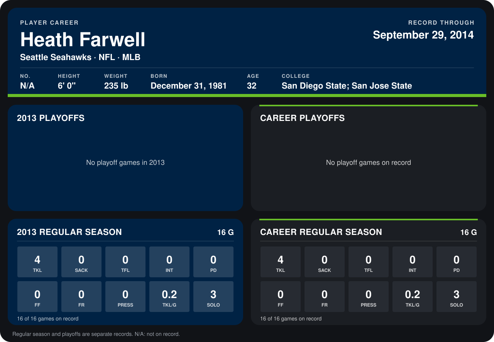

# Heath Farwell

## Career stats

### Regular season

| Season | Club | G | TKL | SACK | TFL | INT | PD | FF | FR | PRESS | TKL/G | SOLO |
|---|---|---:|---:|---:|---:|---:|---:|---:|---:|---:|---:|---:|
| 2013 | Seattle Seahawks | 16 | 4 | 0 | 0 | 0 | 0 | 0 | 0 | 0 | 0.2 | 3 |
| **Career** |  | 16 | 4 | 0 | 0 | 0 | 0 | 0 | 0 | 0 | 0.2 | 3 |

### Playoffs

No playoff games on record.

## Awards

None on record.

Records through September 29, 2014. Identity: the public player file's latest listing (no 2014 Weeks 1-4 roster row). [All Seattle Seahawks players](README.md).
