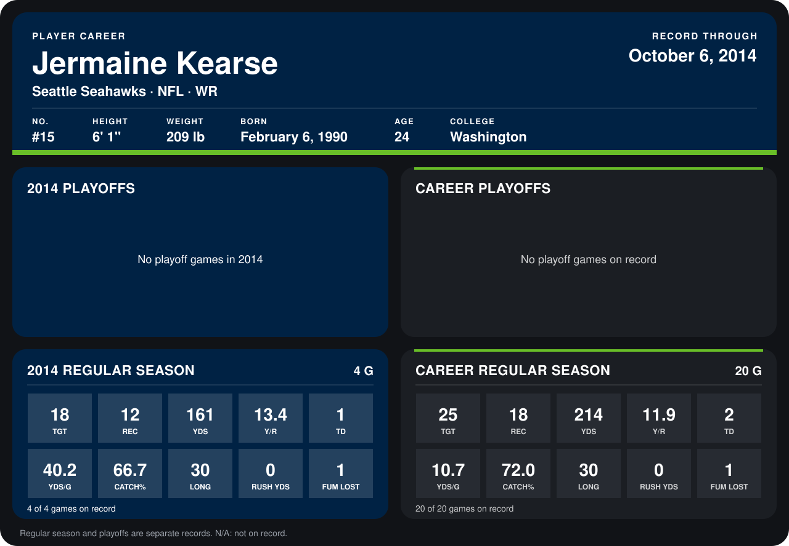

# Jermaine Kearse

## Career stats

### Regular season

| Season | Club | G | TGT | REC | YDS | Y/R | TD | YDS/G | CATCH% | LONG | RUSH YDS | FUM LOST |
|---|---|---:|---:|---:|---:|---:|---:|---:|---:|---:|---:|---:|
| 2013 | Seattle Seahawks | 16 | 7 | 6 | 53 | 8.8 | 1 | 3.3 | 85.7 | 24 | 0 | 0 |
| 2014 | Seattle Seahawks | 3 | 15 | 12 | 161 | 13.4 | 1 | 53.7 | 80.0 | 30 | 0 | 1 |
| **Career** |  | 19 | 22 | 18 | 214 | 11.9 | 2 | 11.3 | 81.8 | 30 | 0 | 1 |

### Playoffs

No playoff games on record.

## Awards

None on record.

Records through September 21, 2014. Identity: listed 2014 roster data, Weeks 1-4; number: 2014 Week 1 roster. [All Seattle Seahawks players](README.md).
