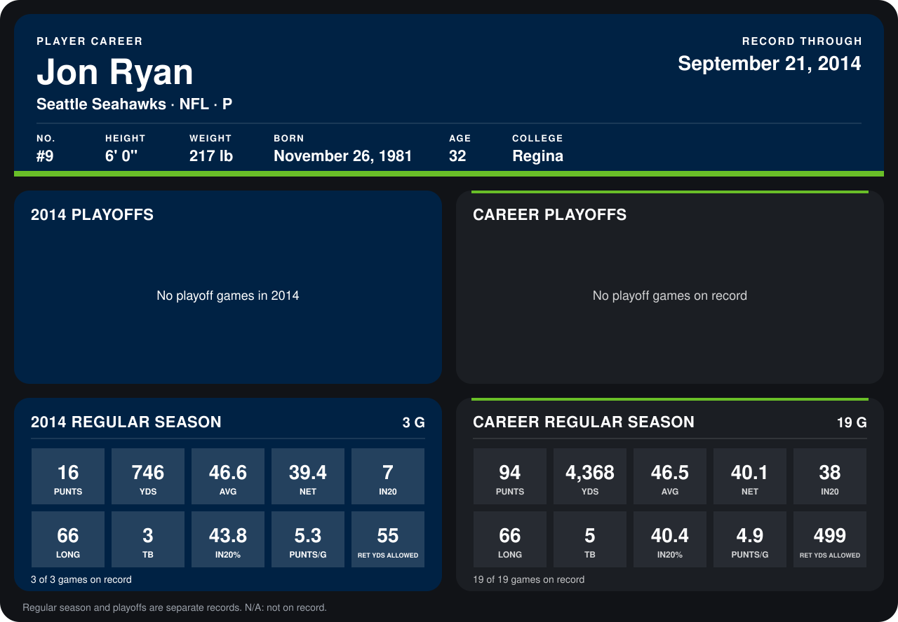

# Jon Ryan

## Career stats

### Regular season

| Season | Team | Age | # | G | PUNTS | YDS | AVG | NET | IN20 | LONG | TB | IN20% | PUNTS/G | RET YDS ALLOWED |
|---|---|---:|---:|---:|---:|---:|---:|---:|---:|---:|---:|---:|---:|---:|
| 2013 | Seattle Seahawks | 31 | 9 | 16 | 78 | 3,622 | 46.4 | 40.2 | 31 | 65 | 2 | 39.7 | 4.9 | 444 |
| 2014 | Seattle Seahawks | 32 | 9 | 3 | 16 | 746 | 46.6 | 39.4 | 7 | 66 | 3 | 43.8 | 5.3 | 55 |
| **Career** |  |  |  | 19 | 94 | 4,368 | 46.5 | 40.1 | 38 | 66 | 5 | 40.4 | 4.9 | 499 |

### Playoffs

No playoff games on record.

## Awards

- NFC Special Teams Player of the Week (2013, Week 13)

Age is his age on the league's opening game of each season; # is the number listed for him that season with that team (2014: the card's rule; 2013: the 2013 season roster), N/A where no listing applies.

Records through September 21, 2014. Identity: listed 2014 roster data, Weeks 1-4; number: 2014 Week 1 roster. [All Seattle Seahawks players](README.md).
