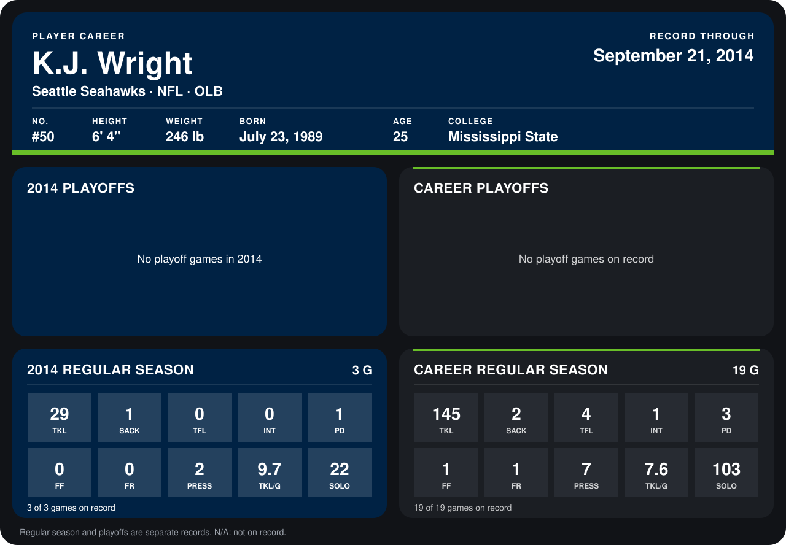

# K.J. Wright

## Career stats

### Regular season

| Season | Club | G | TKL | SACK | TFL | INT | PD | FF | FR | PRESS | TKL/G | SOLO |
|---|---|---:|---:|---:|---:|---:|---:|---:|---:|---:|---:|---:|
| 2013 | Seattle Seahawks | 16 | 116 | 1 | 4 | 1 | 2 | 1 | 1 | 5 | 7.2 | 81 |
| 2014 | Seattle Seahawks | 3 | 29 | 1 | 0 | 0 | 1 | 0 | 0 | 2 | 9.7 | 22 |
| **Career** |  | 19 | 145 | 2 | 4 | 1 | 3 | 1 | 1 | 7 | 7.6 | 103 |

### Playoffs

No playoff games on record.

## Awards

None on record.

Records through September 21, 2014. Identity: listed 2014 roster data, Weeks 1-4; number: 2014 Week 1 roster. [All Seattle Seahawks players](README.md).
