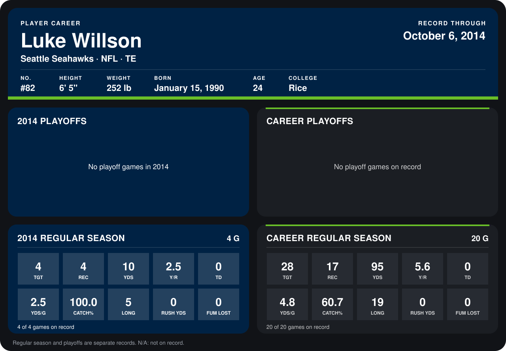

# Luke Willson

## Career stats

### Regular season

| Season | Team | Age | # | G | TGT | REC | YDS | Y/R | TD | YDS/G | CATCH% | LONG | RUSH YDS | FUM LOST |
|---|---|---:|---:|---:|---:|---:|---:|---:|---:|---:|---:|---:|---:|---:|
| 2013 | Seattle Seahawks | 23 | 82 | 16 | 24 | 13 | 85 | 6.5 | 0 | 5.3 | 54.2 | 19 | 0 | 0 |
| 2014 | Seattle Seahawks | 24 | 82 | 3 | 1 | 1 | 2 | 2.0 | 0 | 0.7 | 100.0 | 2 | 0 | 0 |
| **Career** |  |  |  | 19 | 25 | 14 | 87 | 6.2 | 0 | 4.6 | 56.0 | 19 | 0 | 0 |

### Playoffs

No playoff games on record.

## Awards

None on record.

Age is his age on the league's opening game of each season; # is the number listed for him that season with that team (2014: the card's rule; 2013: the 2013 season roster), N/A where no listing applies.

Records through September 21, 2014. Identity: listed 2014 roster data, Weeks 1-4; number: 2014 Week 1 roster. [All Seattle Seahawks players](README.md).
