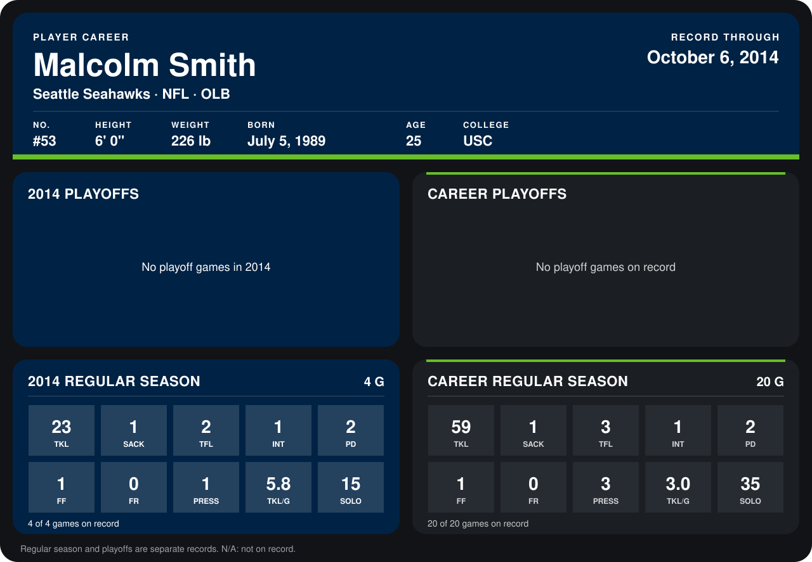

# Malcolm Smith

## Career stats

### Regular season

| Season | Club | G | TKL | SACK | TFL | INT | PD | FF | FR | PRESS | TKL/G | SOLO |
|---|---|---:|---:|---:|---:|---:|---:|---:|---:|---:|---:|---:|
| 2013 | Seattle Seahawks | 16 | 36 | 0 | 1 | 0 | 0 | 0 | 0 | 2 | 2.2 | 20 |
| 2014 | Seattle Seahawks | 4 | 23 | 1 | 2 | 1 | 2 | 1 | 0 | 1 | 5.8 | 15 |
| **Career** |  | 20 | 59 | 1 | 3 | 1 | 2 | 1 | 0 | 3 | 3.0 | 35 |

### Playoffs

No playoff games on record.

## Awards

- NFC Defensive Player of the Week (2014, Week 5)

Records through October 6, 2014. Identity: listed 2014 roster data, Weeks 1-4; number: 2014 Week 1 roster. [All Seattle Seahawks players](README.md).
