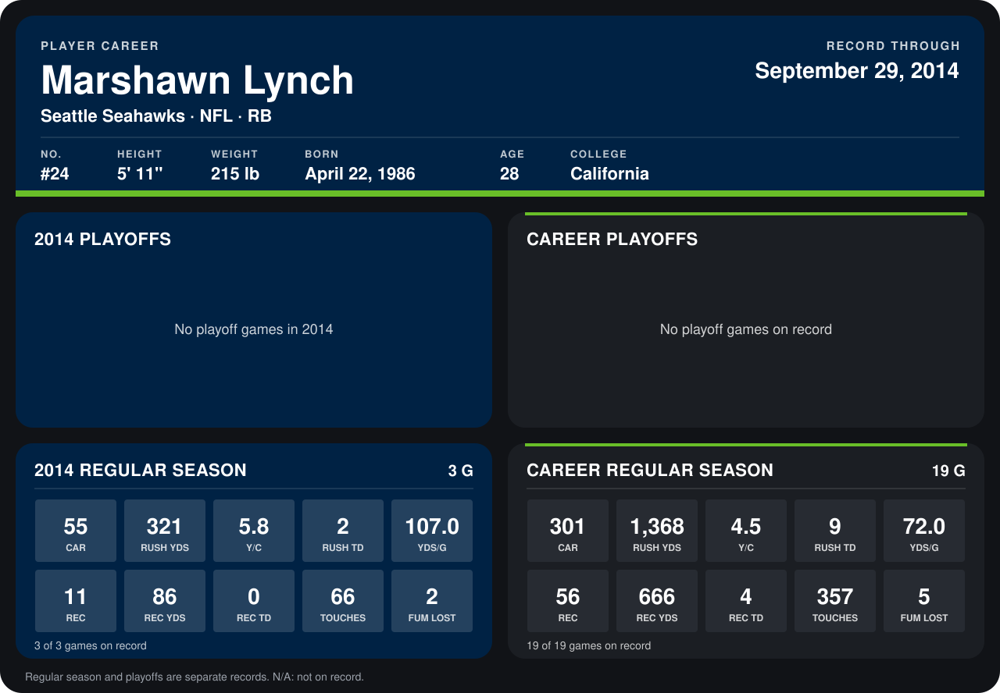

# Marshawn Lynch

## Career stats

### Regular season

| Season | Club | G | CAR | RUSH YDS | Y/C | RUSH TD | YDS/G | REC | REC YDS | REC TD | TOUCHES | FUM LOST |
|---|---|---:|---:|---:|---:|---:|---:|---:|---:|---:|---:|---:|
| 2013 | Seattle Seahawks | 16 | 246 | 1,047 | 4.3 | 7 | 65.4 | 45 | 580 | 4 | 291 | 3 |
| 2014 | Seattle Seahawks | 3 | 55 | 321 | 5.8 | 2 | 107.0 | 11 | 86 | 0 | 66 | 2 |
| **Career** |  | 19 | 301 | 1,368 | 4.5 | 9 | 72.0 | 56 | 666 | 4 | 357 | 5 |

### Playoffs

No playoff games on record.

## Awards

None on record.

Records through September 29, 2014. Identity: listed 2014 roster data, Weeks 1-4; number: 2014 Week 1 roster. [All Seattle Seahawks players](README.md).
