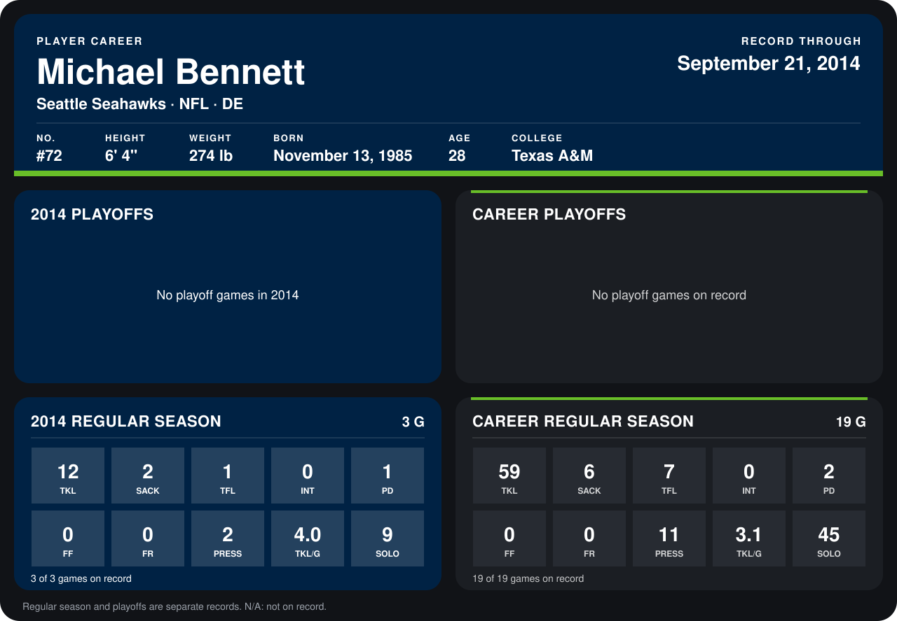

# Michael Bennett

## Career stats

### Regular season

| Season | Club | G | TKL | SACK | TFL | INT | PD | FF | FR | PRESS | TKL/G | SOLO |
|---|---|---:|---:|---:|---:|---:|---:|---:|---:|---:|---:|---:|
| 2013 | Seattle Seahawks | 16 | 47 | 4 | 6 | 0 | 1 | 0 | 0 | 9 | 2.9 | 36 |
| 2014 | Seattle Seahawks | 3 | 12 | 2 | 1 | 0 | 1 | 0 | 0 | 2 | 4.0 | 9 |
| **Career** |  | 19 | 59 | 6 | 7 | 0 | 2 | 0 | 0 | 11 | 3.1 | 45 |

### Playoffs

No playoff games on record.

## Awards

None on record.

Records through September 21, 2014. Identity: listed 2014 roster data, Weeks 1-4; number: 2014 Week 1 roster. [All Seattle Seahawks players](README.md).
