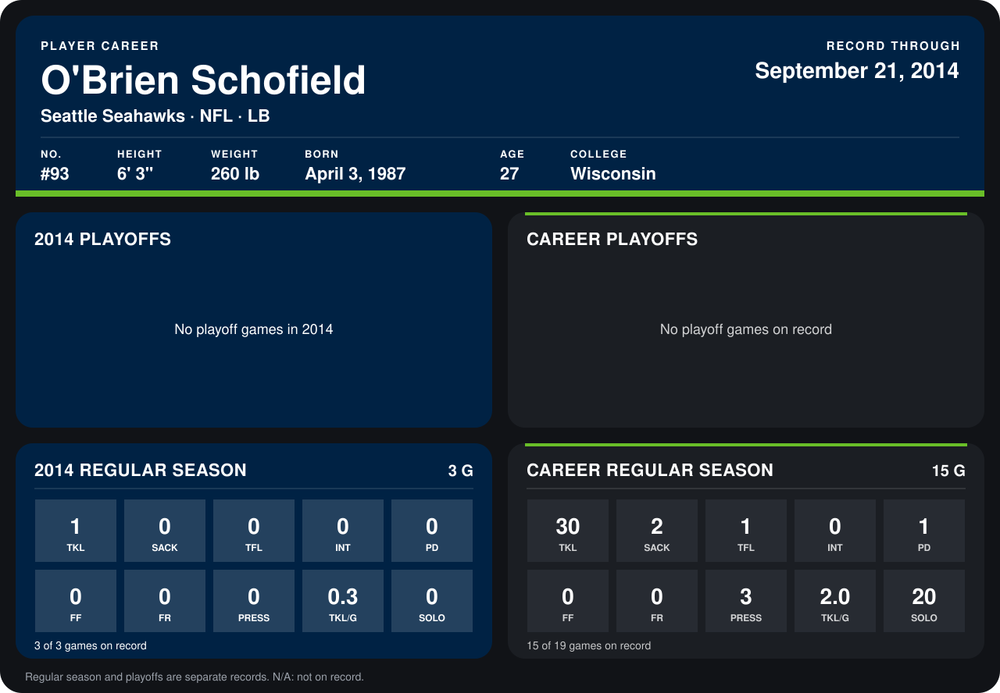

# O'Brien Schofield

## Career stats

### Regular season

| Season | Club | G | TKL | SACK | TFL | INT | PD | FF | FR | PRESS | TKL/G | SOLO |
|---|---|---:|---:|---:|---:|---:|---:|---:|---:|---:|---:|---:|
| 2013 | Seattle Seahawks | 12 | 29 | 2 | 1 | 0 | 1 | 0 | 0 | 3 | 2.4 | 20 |
| 2014 | Seattle Seahawks | 3 | 1 | 0 | 0 | 0 | 0 | 0 | 0 | 0 | 0.3 | 0 |
| **Career** |  | 15 | 30 | 2 | 1 | 0 | 1 | 0 | 0 | 3 | 2.0 | 20 |

### Playoffs

No playoff games on record.

## Awards

None on record.

Records through September 21, 2014. Identity: listed 2014 roster data, Weeks 1-4; number: 2014 Week 1 roster. [All Seattle Seahawks players](README.md).
