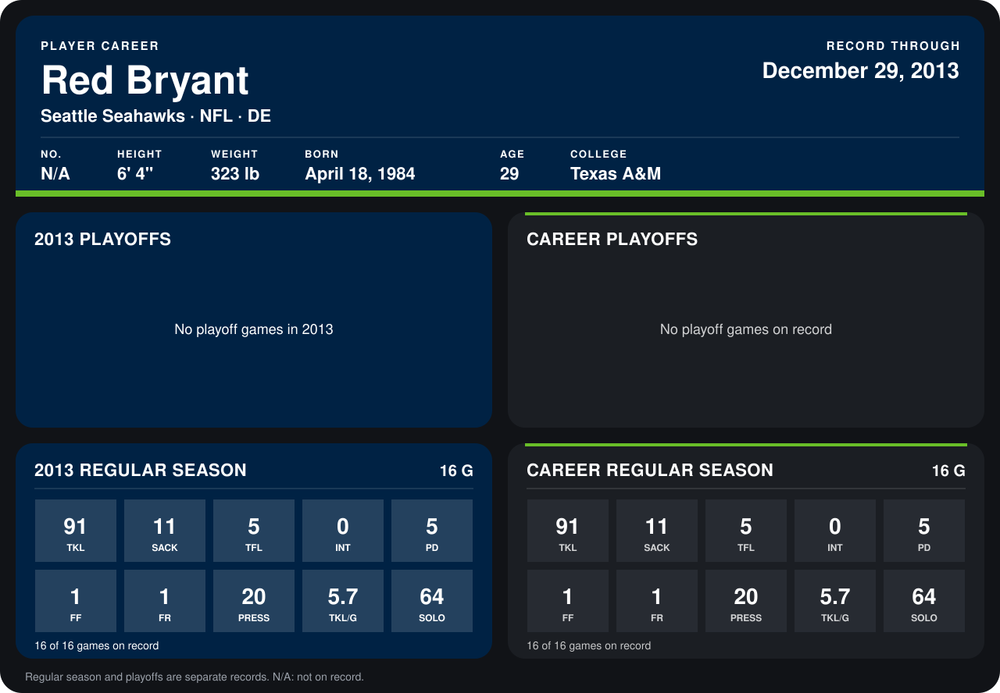

# Red Bryant

## Career stats

### Regular season

| Season | Club | G | TKL | SACK | TFL | INT | PD | FF | FR | PRESS | TKL/G | SOLO |
|---|---|---:|---:|---:|---:|---:|---:|---:|---:|---:|---:|---:|
| 2013 | Seattle Seahawks | 16 | 91 | 11 | 5 | 0 | 5 | 1 | 1 | 20 | 5.7 | 64 |
| **Career** |  | 16 | 91 | 11 | 5 | 0 | 5 | 1 | 1 | 20 | 5.7 | 64 |

### Playoffs

No playoff games on record.

## Awards

- AP Second-Team All-Pro (2013, DE)
- Pro Bowl selection (2013, DE)

Records through September 29, 2014. Identity: listed 2014 roster data, Weeks 1-4. [All Seattle Seahawks players](README.md).
