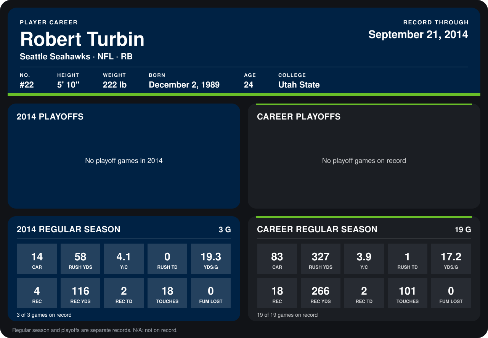

# Robert Turbin

## Career stats

### Regular season

| Season | Team | Age | # | G | CAR | RUSH YDS | Y/C | RUSH TD | YDS/G | REC | REC YDS | REC TD | TOUCHES | FUM LOST |
|---|---|---:|---:|---:|---:|---:|---:|---:|---:|---:|---:|---:|---:|---:|
| 2013 | Seattle Seahawks | 23 | 22 | 16 | 69 | 269 | 3.9 | 1 | 16.8 | 14 | 150 | 0 | 83 | 0 |
| 2014 | Seattle Seahawks | 24 | 22 | 3 | 14 | 58 | 4.1 | 0 | 19.3 | 4 | 116 | 2 | 18 | 0 |
| **Career** |  |  |  | 19 | 83 | 327 | 3.9 | 1 | 17.2 | 18 | 266 | 2 | 101 | 0 |

### Playoffs

No playoff games on record.

## Awards

None on record.

Age is his age on the league's opening game of each season; # is the number listed for him that season with that team (2014: the card's rule; 2013: the 2013 season roster), N/A where no listing applies.

Records through September 21, 2014. Identity: listed 2014 roster data, Weeks 1-4; number: 2014 Week 1 roster. [All Seattle Seahawks players](README.md).
