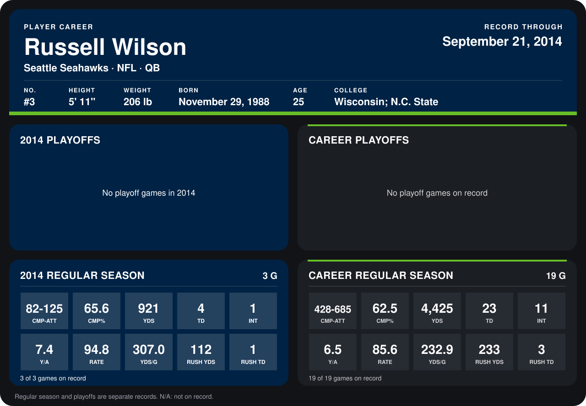

# Russell Wilson

## Career stats

### Regular season

| Season | Team | Age | # | G | CMP-ATT | CMP% | YDS | TD | INT | Y/A | RATE | YDS/G | RUSH YDS | RUSH TD |
|---|---|---:|---:|---:|---:|---:|---:|---:|---:|---:|---:|---:|---:|---:|
| 2013 | Seattle Seahawks | 24 | 3 | 16 | 346-560 | 61.8 | 3,504 | 19 | 10 | 6.3 | 83.5 | 219.0 | 121 | 2 |
| 2014 | Seattle Seahawks | 25 | 3 | 3 | 82-125 | 65.6 | 921 | 4 | 1 | 7.4 | 94.8 | 307.0 | 112 | 1 |
| **Career** |  |  |  | 19 | 428-685 | 62.5 | 4,425 | 23 | 11 | 6.5 | 85.6 | 232.9 | 233 | 3 |

### Playoffs

No playoff games on record.

## Awards

None on record.

Age is his age on the league's opening game of each season; # is the number listed for him that season with that team (2014: the card's rule; 2013: the 2013 season roster), N/A where no listing applies.

Records through September 21, 2014. Identity: listed 2014 roster data, Weeks 1-4; number: 2014 Week 1 roster. [All Seattle Seahawks players](README.md).
