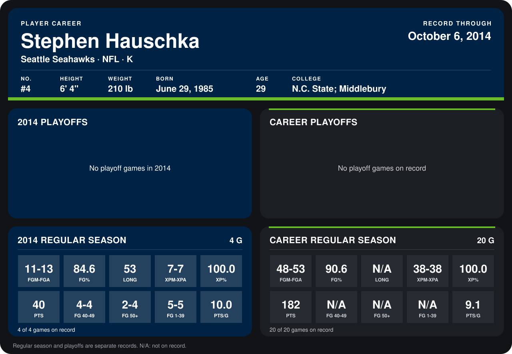

# Stephen Hauschka

## Career stats

### Regular season

| Season | Club | G | FGM-FGA | FG% | LONG | XPM-XPA | XP% | PTS | FG 40-49 | FG 50+ | FG 1-39 | PTS/G |
|---|---|---:|---:|---:|---:|---:|---:|---:|---:|---:|---:|---:|
| 2013 | Seattle Seahawks | 16 | 37-40 | 92.5 | N/A | 31-31 | 100.0 | 142 | N/A | N/A | N/A | 8.9 |
| 2014 | Seattle Seahawks | 4 | 11-13 | 84.6 | 53 | 7-7 | 100.0 | 40 | 4-4 | 2-4 | 5-5 | 10.0 |
| **Career** |  | 20 | 48-53 | 90.6 | N/A | 38-38 | 100.0 | 182 | N/A | N/A | N/A | 9.1 |

### Playoffs

No playoff games on record.

## Awards

- AP Second-Team All-Pro (2013, K)
- Pro Bowl selection (2013, K)

Records through October 6, 2014. Identity: listed 2014 roster data, Weeks 1-4; number: 2014 Week 1 roster. [All Seattle Seahawks players](README.md).
