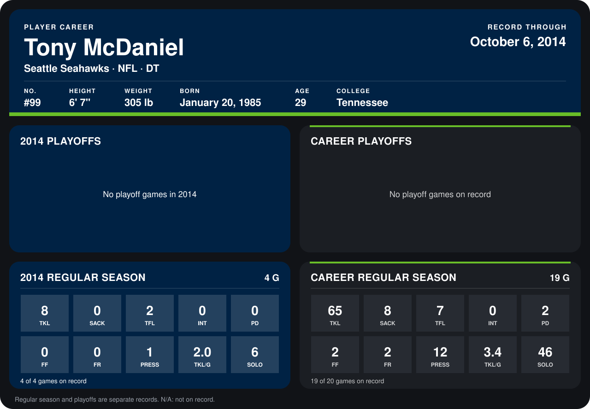

# Tony McDaniel

## Career stats

### Regular season

| Season | Club | G | TKL | SACK | TFL | INT | PD | FF | FR | PRESS | TKL/G | SOLO |
|---|---|---:|---:|---:|---:|---:|---:|---:|---:|---:|---:|---:|
| 2013 | Seattle Seahawks | 15 | 57 | 8 | 5 | 0 | 2 | 2 | 2 | 11 | 3.8 | 40 |
| 2014 | Seattle Seahawks | 3 | 3 | 0 | 0 | 0 | 0 | 0 | 0 | 0 | 1.0 | 3 |
| **Career** |  | 18 | 60 | 8 | 5 | 0 | 2 | 2 | 2 | 11 | 3.3 | 43 |

### Playoffs

No playoff games on record.

## Awards

None on record.

Records through September 29, 2014. Identity: listed 2014 roster data, Weeks 1-4; number: 2014 Week 1 roster. [All Seattle Seahawks players](README.md).
