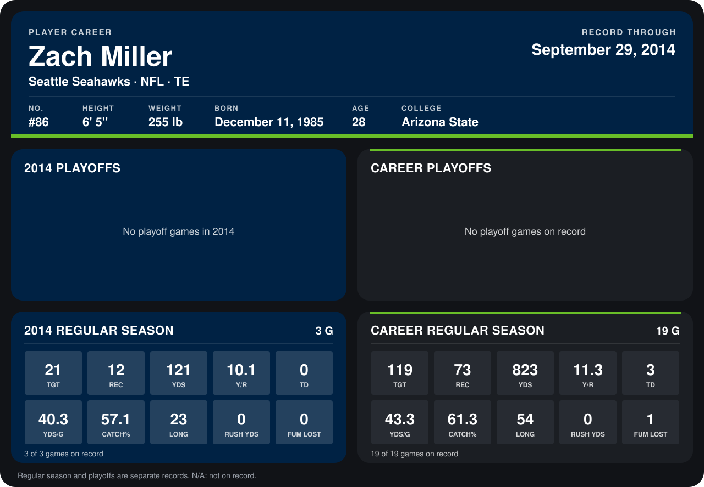

# Zach Miller

## Career stats

### Regular season

| Season | Club | G | TGT | REC | YDS | Y/R | TD | YDS/G | CATCH% | LONG | RUSH YDS | FUM LOST |
|---|---|---:|---:|---:|---:|---:|---:|---:|---:|---:|---:|---:|
| 2013 | Seattle Seahawks | 16 | 98 | 61 | 702 | 11.5 | 3 | 43.9 | 62.2 | 54 | 0 | 1 |
| 2014 | Seattle Seahawks | 4 | 27 | 15 | 178 | 11.9 | 0 | 44.5 | 55.6 | 28 | 0 | 0 |
| **Career** |  | 20 | 125 | 76 | 880 | 11.6 | 3 | 44.0 | 60.8 | 54 | 0 | 1 |

### Playoffs

No playoff games on record.

## Awards

None on record.

Records through October 6, 2014. Identity: listed 2014 roster data, Weeks 1-4; number: 2014 Week 1 roster. [All Seattle Seahawks players](README.md).
