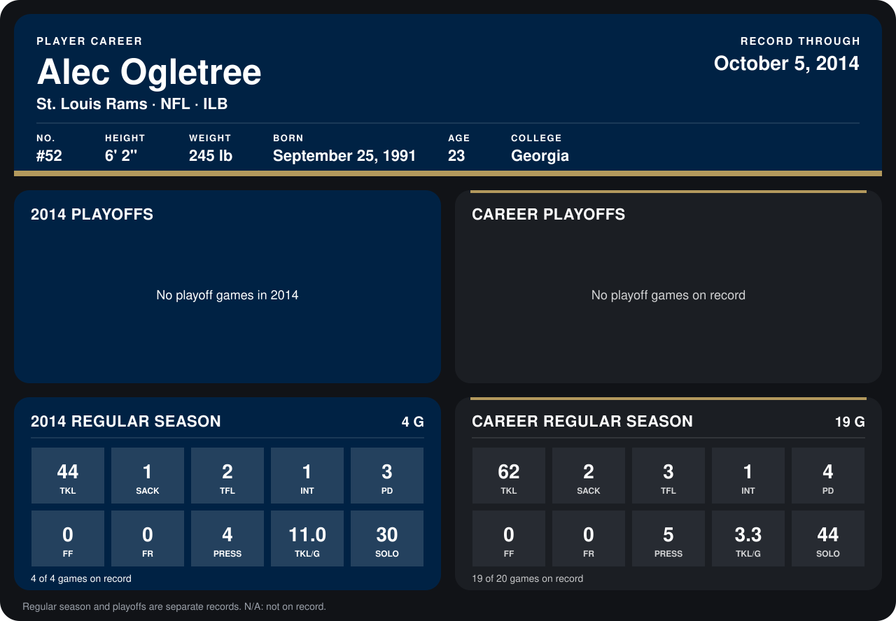

# Alec Ogletree

## Career stats

### Regular season

| Season | Club | G | TKL | SACK | TFL | INT | PD | FF | FR | PRESS | TKL/G | SOLO |
|---|---|---:|---:|---:|---:|---:|---:|---:|---:|---:|---:|---:|
| 2013 | St. Louis Rams | 15 | 18 | 1 | 1 | 0 | 1 | 0 | 0 | 1 | 1.2 | 14 |
| 2014 | St. Louis Rams | 4 | 44 | 1 | 2 | 1 | 3 | 0 | 0 | 4 | 11.0 | 30 |
| **Career** |  | 19 | 62 | 2 | 3 | 1 | 4 | 0 | 0 | 5 | 3.3 | 44 |

### Playoffs

No playoff games on record.

## Awards

None on record.

Records through October 5, 2014. Identity: listed 2014 roster data, Weeks 1-4; number: 2014 Week 1 roster. [All St. Louis Rams players](README.md).
