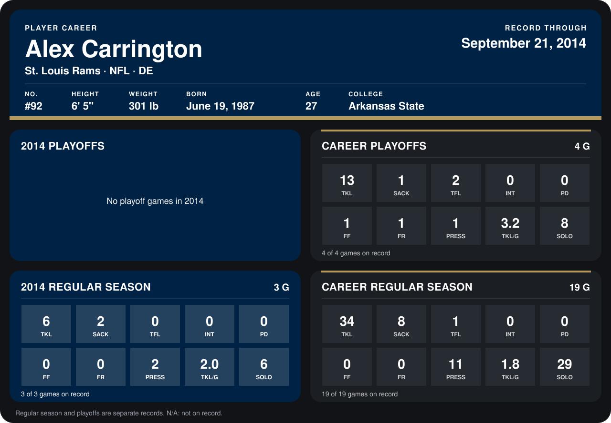

# Alex Carrington

## Career stats

### Regular season

| Season | Club | G | TKL | SACK | TFL | INT | PD | FF | FR | PRESS | TKL/G | SOLO |
|---|---|---:|---:|---:|---:|---:|---:|---:|---:|---:|---:|---:|
| 2013 | Buffalo Bills | 16 | 28 | 6 | 1 | 0 | 0 | 0 | 0 | 9 | 1.8 | 23 |
| 2014 | St. Louis Rams | 4 | 8 | 3 | 0 | 0 | 0 | 1 | 0 | 3 | 2.0 | 8 |
| **Career** |  | 20 | 36 | 9 | 1 | 0 | 0 | 1 | 0 | 12 | 1.8 | 31 |

### Playoffs

| Season | Club | G | TKL | SACK | TFL | INT | PD | FF | FR | PRESS | TKL/G | SOLO |
|---|---|---:|---:|---:|---:|---:|---:|---:|---:|---:|---:|---:|
| 2013 | Buffalo Bills | 4 | 13 | 1 | 2 | 0 | 0 | 1 | 1 | 1 | 3.2 | 8 |
| **Career** |  | 4 | 13 | 1 | 2 | 0 | 0 | 1 | 1 | 1 | 3.2 | 8 |

## Awards

None on record.

Records through October 5, 2014. Identity: listed 2014 roster data, Weeks 1-4; number: 2014 Week 1 roster. [All St. Louis Rams players](README.md).
