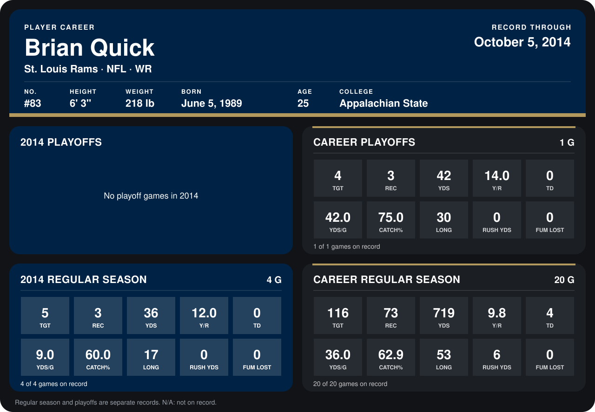

# Brian Quick

## Career stats

### Regular season

| Season | Club | G | TGT | REC | YDS | Y/R | TD | YDS/G | CATCH% | LONG | RUSH YDS | FUM LOST |
|---|---|---:|---:|---:|---:|---:|---:|---:|---:|---:|---:|---:|
| 2013 | St. Louis Rams | 16 | 111 | 70 | 683 | 9.8 | 4 | 42.7 | 63.1 | 53 | 6 | 0 |
| 2014 | St. Louis Rams | 3 | 4 | 3 | 36 | 12.0 | 0 | 12.0 | 75.0 | 17 | 0 | 0 |
| **Career** |  | 19 | 115 | 73 | 719 | 9.8 | 4 | 37.8 | 63.5 | 53 | 6 | 0 |

### Playoffs

| Season | Club | G | TGT | REC | YDS | Y/R | TD | YDS/G | CATCH% | LONG | RUSH YDS | FUM LOST |
|---|---|---:|---:|---:|---:|---:|---:|---:|---:|---:|---:|---:|
| 2013 | St. Louis Rams | 1 | 4 | 3 | 42 | 14.0 | 0 | 42.0 | 75.0 | 30 | 0 | 0 |
| **Career** |  | 1 | 4 | 3 | 42 | 14.0 | 0 | 42.0 | 75.0 | 30 | 0 | 0 |

## Awards

None on record.

Records through September 29, 2014. Identity: listed 2014 roster data, Weeks 1-4; number: 2014 Week 1 roster. [All St. Louis Rams players](README.md).
