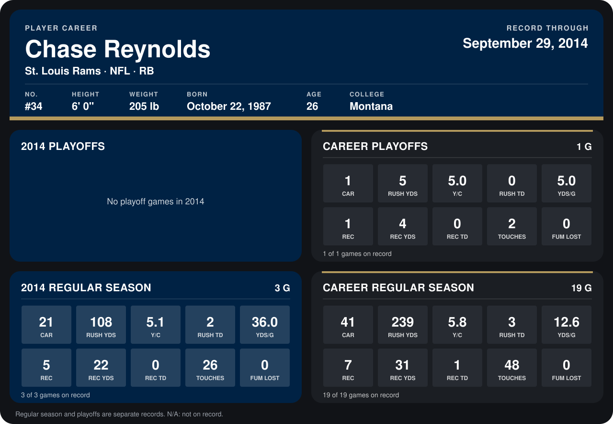

# Chase Reynolds

## Career stats

### Regular season

| Season | Team | Age | # | G | CAR | RUSH YDS | Y/C | RUSH TD | YDS/G | REC | REC YDS | REC TD | TOUCHES | FUM LOST |
|---|---|---:|---:|---:|---:|---:|---:|---:|---:|---:|---:|---:|---:|---:|
| 2013 | St. Louis Rams | 25 | 34 | 16 | 20 | 131 | 6.5 | 1 | 8.2 | 2 | 9 | 1 | 22 | 0 |
| 2014 | St. Louis Rams | 26 | 34 | 3 | 21 | 108 | 5.1 | 2 | 36.0 | 5 | 22 | 0 | 26 | 0 |
| **Career** |  |  |  | 19 | 41 | 239 | 5.8 | 3 | 12.6 | 7 | 31 | 1 | 48 | 0 |

### Playoffs

| Season | Team | Age | # | G | CAR | RUSH YDS | Y/C | RUSH TD | YDS/G | REC | REC YDS | REC TD | TOUCHES | FUM LOST |
|---|---|---:|---:|---:|---:|---:|---:|---:|---:|---:|---:|---:|---:|---:|
| 2013 | St. Louis Rams | 25 | 34 | 1 | 1 | 5 | 5.0 | 0 | 5.0 | 1 | 4 | 0 | 2 | 0 |
| **Career** |  |  |  | 1 | 1 | 5 | 5.0 | 0 | 5.0 | 1 | 4 | 0 | 2 | 0 |

## Awards

None on record.

Age is his age on the league's opening game of each season; # is the number listed for him that season with that team (2014: the card's rule; 2013: the 2013 season roster), N/A where no listing applies.

Records through September 21, 2014. Identity: listed 2014 roster data, Weeks 1-4; number: 2014 Week 1 roster. [All St. Louis Rams players](README.md).
