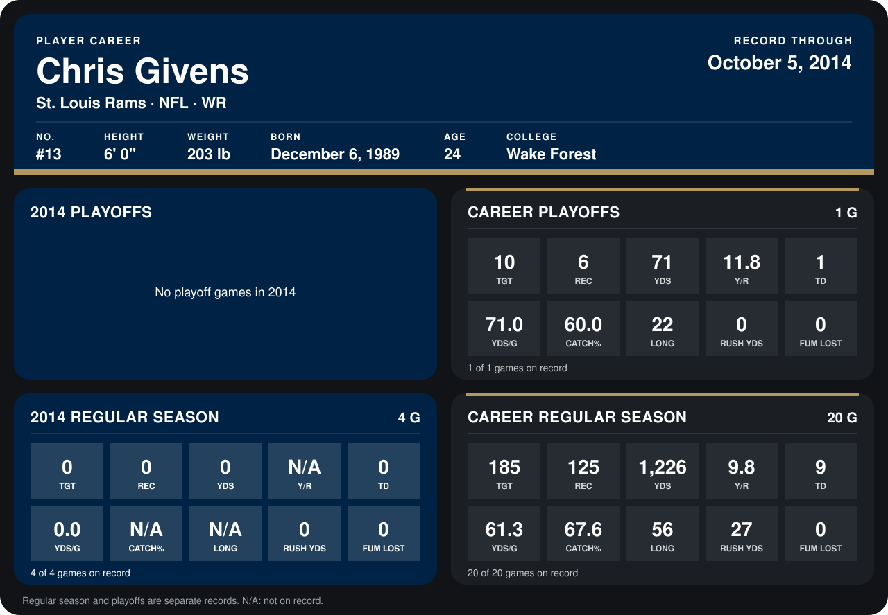

# Chris Givens

## Career stats

### Regular season

| Season | Club | G | TGT | REC | YDS | Y/R | TD | YDS/G | CATCH% | LONG | RUSH YDS | FUM LOST |
|---|---|---:|---:|---:|---:|---:|---:|---:|---:|---:|---:|---:|
| 2013 | St. Louis Rams | 16 | 185 | 125 | 1,226 | 9.8 | 9 | 76.6 | 67.6 | 56 | 27 | 0 |
| 2014 | St. Louis Rams | 3 | 0 | 0 | 0 | N/A | 0 | 0.0 | N/A | N/A | 0 | 0 |
| **Career** |  | 19 | 185 | 125 | 1,226 | 9.8 | 9 | 64.5 | 67.6 | 56 | 27 | 0 |

### Playoffs

| Season | Club | G | TGT | REC | YDS | Y/R | TD | YDS/G | CATCH% | LONG | RUSH YDS | FUM LOST |
|---|---|---:|---:|---:|---:|---:|---:|---:|---:|---:|---:|---:|
| 2013 | St. Louis Rams | 1 | 10 | 6 | 71 | 11.8 | 1 | 71.0 | 60.0 | 22 | 0 | 0 |
| **Career** |  | 1 | 10 | 6 | 71 | 11.8 | 1 | 71.0 | 60.0 | 22 | 0 | 0 |

## Awards

- Pro Bowl selection (2013, WR)

Records through September 29, 2014. Identity: listed 2014 roster data, Weeks 1-4; number: 2014 Week 1 roster. [All St. Louis Rams players](README.md).
