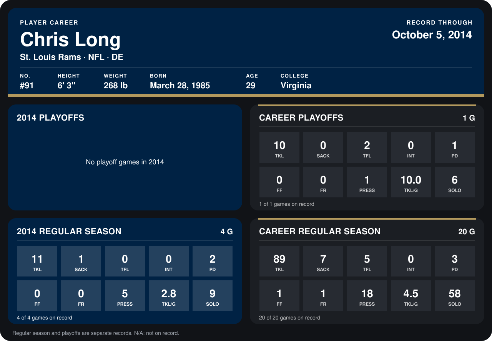

# Chris Long

## Career stats

### Regular season

| Season | Club | G | TKL | SACK | TFL | INT | PD | FF | FR | PRESS | TKL/G | SOLO |
|---|---|---:|---:|---:|---:|---:|---:|---:|---:|---:|---:|---:|
| 2013 | St. Louis Rams | 16 | 78 | 6 | 5 | 0 | 1 | 1 | 1 | 13 | 4.9 | 49 |
| 2014 | St. Louis Rams | 3 | 10 | 1 | 0 | 0 | 2 | 0 | 0 | 5 | 3.3 | 8 |
| **Career** |  | 19 | 88 | 7 | 5 | 0 | 3 | 1 | 1 | 18 | 4.6 | 57 |

### Playoffs

| Season | Club | G | TKL | SACK | TFL | INT | PD | FF | FR | PRESS | TKL/G | SOLO |
|---|---|---:|---:|---:|---:|---:|---:|---:|---:|---:|---:|---:|
| 2013 | St. Louis Rams | 1 | 10 | 0 | 2 | 0 | 1 | 0 | 0 | 1 | 10.0 | 6 |
| **Career** |  | 1 | 10 | 0 | 2 | 0 | 1 | 0 | 0 | 1 | 10.0 | 6 |

## Awards

None on record.

Records through September 21, 2014. Identity: listed 2014 roster data, Weeks 1-4; number: 2014 Week 1 roster. [All St. Louis Rams players](README.md).
