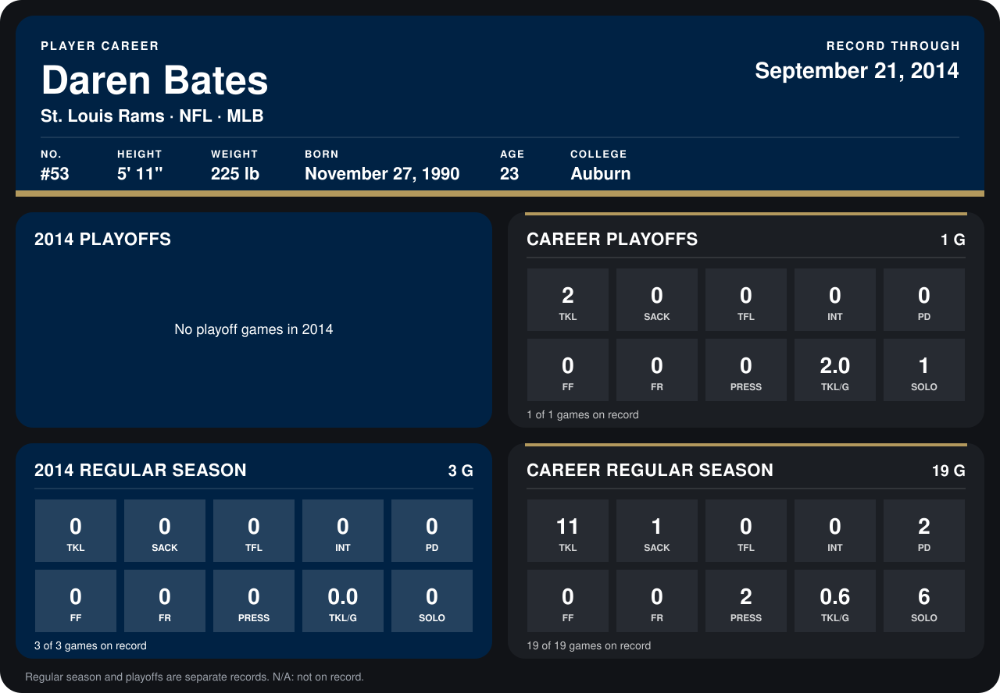

# Daren Bates

## Career stats

### Regular season

| Season | Team | Age | # | G | TKL | SACK | TFL | INT | PD | FF | FR | PRESS | TKL/G | SOLO |
|---|---|---:|---:|---:|---:|---:|---:|---:|---:|---:|---:|---:|---:|---:|
| 2013 | St. Louis Rams | 22 | 53 | 16 | 11 | 1 | 0 | 0 | 2 | 0 | 0 | 2 | 0.7 | 6 |
| 2014 | St. Louis Rams | 23 | 53 | 4 | 0 | 0 | 0 | 0 | 0 | 0 | 0 | 0 | 0.0 | 0 |
| **Career** |  |  |  | 20 | 11 | 1 | 0 | 0 | 2 | 0 | 0 | 2 | 0.6 | 6 |

### Playoffs

| Season | Team | Age | # | G | TKL | SACK | TFL | INT | PD | FF | FR | PRESS | TKL/G | SOLO |
|---|---|---:|---:|---:|---:|---:|---:|---:|---:|---:|---:|---:|---:|---:|
| 2013 | St. Louis Rams | 22 | 53 | 1 | 2 | 0 | 0 | 0 | 0 | 0 | 0 | 0 | 2.0 | 1 |
| **Career** |  |  |  | 1 | 2 | 0 | 0 | 0 | 0 | 0 | 0 | 0 | 2.0 | 1 |

## Awards

None on record.

Age is his age on the league's opening game of each season; # is the number listed for him that season with that team (2014: the card's rule; 2013: the 2013 season roster), N/A where no listing applies.

Records through October 5, 2014. Identity: listed 2014 roster data, Weeks 1-4; number: 2014 Week 1 roster. [All St. Louis Rams players](README.md).
