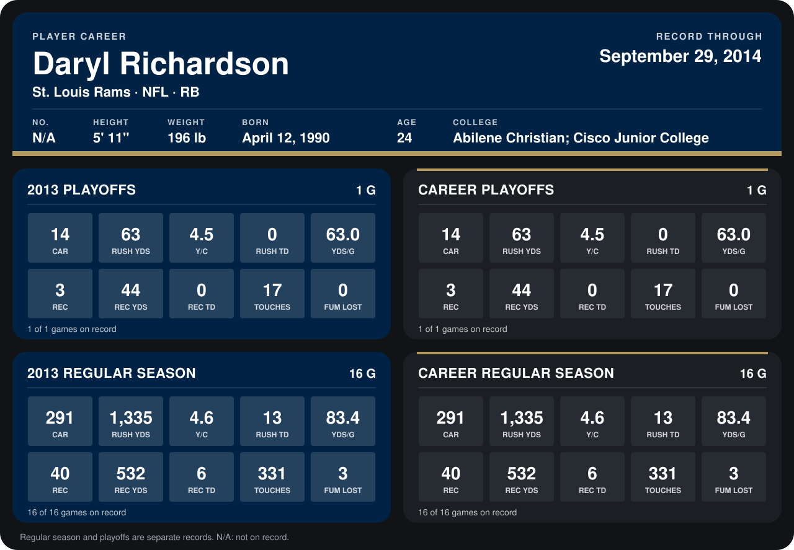

# Daryl Richardson

## Career stats

### Regular season

| Season | Team | Age | # | G | CAR | RUSH YDS | Y/C | RUSH TD | YDS/G | REC | REC YDS | REC TD | TOUCHES | FUM LOST |
|---|---|---:|---:|---:|---:|---:|---:|---:|---:|---:|---:|---:|---:|---:|
| 2013 | St. Louis Rams | 23 | 26 | 16 | 291 | 1,335 | 4.6 | 13 | 83.4 | 40 | 532 | 6 | 331 | 3 |
| **Career** |  |  |  | 16 | 291 | 1,335 | 4.6 | 13 | 83.4 | 40 | 532 | 6 | 331 | 3 |

### Playoffs

| Season | Team | Age | # | G | CAR | RUSH YDS | Y/C | RUSH TD | YDS/G | REC | REC YDS | REC TD | TOUCHES | FUM LOST |
|---|---|---:|---:|---:|---:|---:|---:|---:|---:|---:|---:|---:|---:|---:|
| 2013 | St. Louis Rams | 23 | 26 | 1 | 14 | 63 | 4.5 | 0 | 63.0 | 3 | 44 | 0 | 17 | 0 |
| **Career** |  |  |  | 1 | 14 | 63 | 4.5 | 0 | 63.0 | 3 | 44 | 0 | 17 | 0 |

## Awards

- NFC Offensive Player of the Week (2013, Week 13)
- AP Offensive Player of the Year (2013)
- AP First-Team All-Pro (2013, RB)
- Pro Bowl selection (2013, RB)

Age is his age on the league's opening game of each season; # is the number listed for him that season with that team (2014: the card's rule; 2013: the 2013 season roster), N/A where no listing applies.

Records through January 12, 2014. Identity: his listed 2013 season roster data (no 2014 Weeks 1-4 roster row). [All St. Louis Rams players](README.md).
