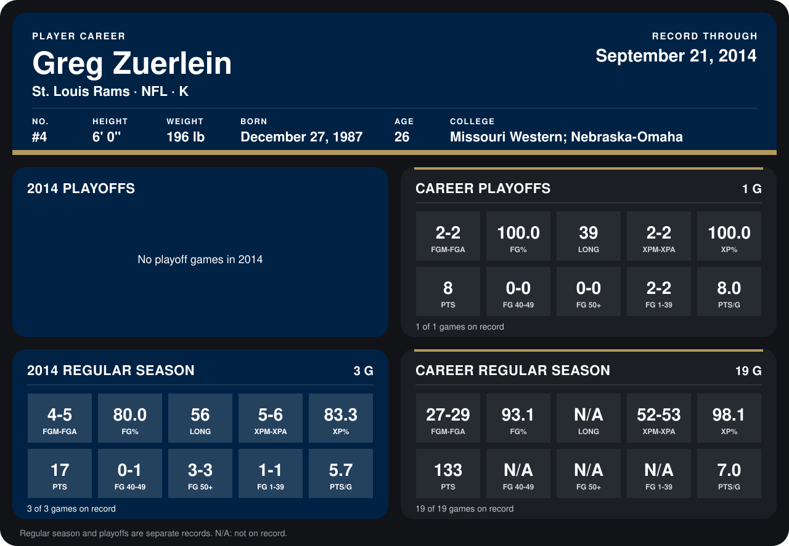

# Greg Zuerlein

## Career stats

### Regular season

| Season | Club | G | FGM-FGA | FG% | LONG | XPM-XPA | XP% | PTS | FG 40-49 | FG 50+ | FG 1-39 | PTS/G |
|---|---|---:|---:|---:|---:|---:|---:|---:|---:|---:|---:|---:|
| 2013 | St. Louis Rams | 16 | 23-24 | 95.8 | N/A | 47-47 | 100.0 | 116 | N/A | N/A | N/A | 7.2 |
| 2014 | St. Louis Rams | 3 | 4-5 | 80.0 | 56 | 5-6 | 83.3 | 17 | 0-1 | 3-3 | 1-1 | 5.7 |
| **Career** |  | 19 | 27-29 | 93.1 | N/A | 52-53 | 98.1 | 133 | N/A | N/A | N/A | 7.0 |

### Playoffs

| Season | Club | G | FGM-FGA | FG% | LONG | XPM-XPA | XP% | PTS | FG 40-49 | FG 50+ | FG 1-39 | PTS/G |
|---|---|---:|---:|---:|---:|---:|---:|---:|---:|---:|---:|---:|
| 2013 | St. Louis Rams | 1 | 2-2 | 100.0 | 39 | 2-2 | 100.0 | 8 | 0-0 | 0-0 | 2-2 | 8.0 |
| **Career** |  | 1 | 2-2 | 100.0 | 39 | 2-2 | 100.0 | 8 | 0-0 | 0-0 | 2-2 | 8.0 |

## Awards

None on record.

Records through September 21, 2014. Identity: listed 2014 roster data, Weeks 1-4; number: 2014 Week 1 roster. [All St. Louis Rams players](README.md).
