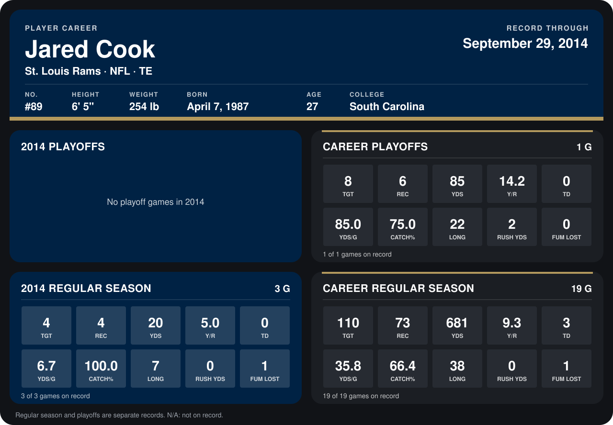

# Jared Cook

## Career stats

### Regular season

| Season | Team | Age | # | G | TGT | REC | YDS | Y/R | TD | YDS/G | CATCH% | LONG | RUSH YDS | FUM LOST |
|---|---|---:|---:|---:|---:|---:|---:|---:|---:|---:|---:|---:|---:|---:|
| 2013 | St. Louis Rams | 26 | 89 | 16 | 106 | 69 | 661 | 9.6 | 3 | 41.3 | 65.1 | 38 | 0 | 0 |
| 2014 | St. Louis Rams | 27 | 89 | 3 | 4 | 4 | 20 | 5.0 | 0 | 6.7 | 100.0 | 7 | 0 | 1 |
| **Career** |  |  |  | 19 | 110 | 73 | 681 | 9.3 | 3 | 35.8 | 66.4 | 38 | 0 | 1 |

### Playoffs

| Season | Team | Age | # | G | TGT | REC | YDS | Y/R | TD | YDS/G | CATCH% | LONG | RUSH YDS | FUM LOST |
|---|---|---:|---:|---:|---:|---:|---:|---:|---:|---:|---:|---:|---:|---:|
| 2013 | St. Louis Rams | 26 | 89 | 1 | 8 | 6 | 85 | 14.2 | 0 | 85.0 | 75.0 | 22 | 2 | 0 |
| **Career** |  |  |  | 1 | 8 | 6 | 85 | 14.2 | 0 | 85.0 | 75.0 | 22 | 2 | 0 |

## Awards

None on record.

Age is his age on the league's opening game of each season; # is the number listed for him that season with that team (2014: the card's rule; 2013: the 2013 season roster), N/A where no listing applies.

Records through September 21, 2014. Identity: listed 2014 roster data, Weeks 1-4; number: 2014 Week 1 roster. [All St. Louis Rams players](README.md).
