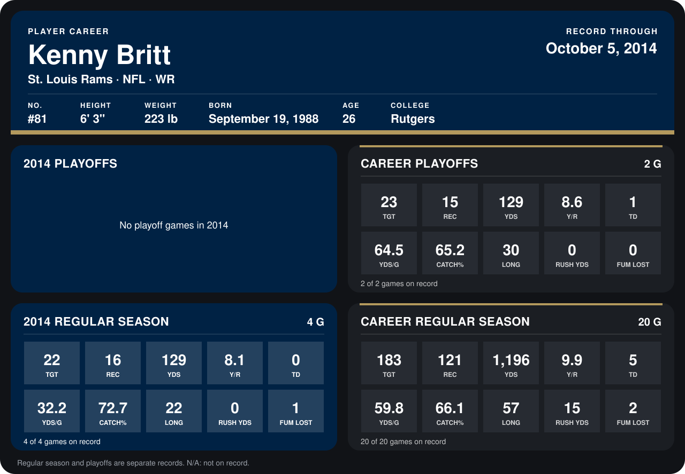

# Kenny Britt

## Career stats

### Regular season

| Season | Team | Age | # | G | TGT | REC | YDS | Y/R | TD | YDS/G | CATCH% | LONG | RUSH YDS | FUM LOST |
|---|---|---:|---:|---:|---:|---:|---:|---:|---:|---:|---:|---:|---:|---:|
| 2013 | Tennessee Titans | 24 | 18 | 16 | 161 | 105 | 1,067 | 10.2 | 5 | 66.7 | 65.2 | 57 | 15 | 1 |
| 2014 | St. Louis Rams | 25 | 81 | 3 | 15 | 13 | 118 | 9.1 | 0 | 39.3 | 86.7 | 22 | 0 | 1 |
| **Career** |  |  |  | 19 | 176 | 118 | 1,185 | 10.0 | 5 | 62.4 | 67.0 | 57 | 15 | 2 |

### Playoffs

| Season | Team | Age | # | G | TGT | REC | YDS | Y/R | TD | YDS/G | CATCH% | LONG | RUSH YDS | FUM LOST |
|---|---|---:|---:|---:|---:|---:|---:|---:|---:|---:|---:|---:|---:|---:|
| 2013 | Tennessee Titans | 24 | 18 | 2 | 23 | 15 | 129 | 8.6 | 1 | 64.5 | 65.2 | 30 | 0 | 0 |
| **Career** |  |  |  | 2 | 23 | 15 | 129 | 8.6 | 1 | 64.5 | 65.2 | 30 | 0 | 0 |

## Awards

None on record.

Age is his age on the league's opening game of each season; # is the number listed for him that season with that team (2014: the card's rule; 2013: the 2013 season roster), N/A where no listing applies.

Records through September 21, 2014. Identity: listed 2014 roster data, Weeks 1-4; number: 2014 Week 1 roster. [All St. Louis Rams players](README.md).
