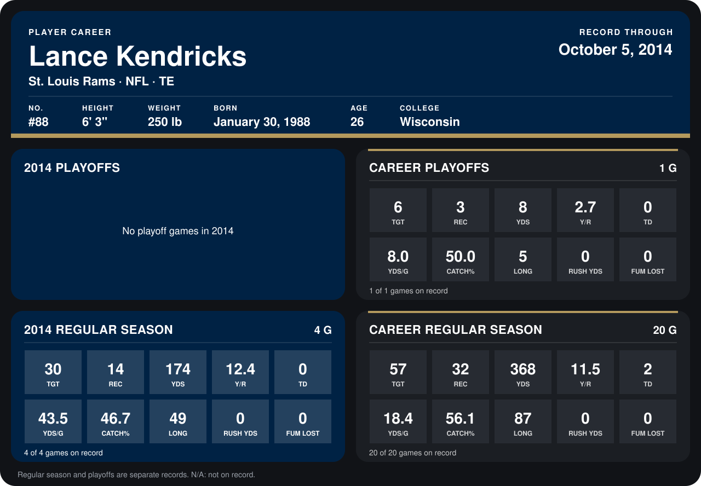

# Lance Kendricks

## Career stats

### Regular season

| Season | Club | G | TGT | REC | YDS | Y/R | TD | YDS/G | CATCH% | LONG | RUSH YDS | FUM LOST |
|---|---|---:|---:|---:|---:|---:|---:|---:|---:|---:|---:|---:|
| 2013 | St. Louis Rams | 16 | 27 | 18 | 194 | 10.8 | 2 | 12.1 | 66.7 | 87 | 0 | 0 |
| 2014 | St. Louis Rams | 4 | 30 | 14 | 174 | 12.4 | 0 | 43.5 | 46.7 | 49 | 0 | 0 |
| **Career** |  | 20 | 57 | 32 | 368 | 11.5 | 2 | 18.4 | 56.1 | 87 | 0 | 0 |

### Playoffs

| Season | Club | G | TGT | REC | YDS | Y/R | TD | YDS/G | CATCH% | LONG | RUSH YDS | FUM LOST |
|---|---|---:|---:|---:|---:|---:|---:|---:|---:|---:|---:|---:|
| 2013 | St. Louis Rams | 1 | 6 | 3 | 8 | 2.7 | 0 | 8.0 | 50.0 | 5 | 0 | 0 |
| **Career** |  | 1 | 6 | 3 | 8 | 2.7 | 0 | 8.0 | 50.0 | 5 | 0 | 0 |

## Awards

None on record.

Records through October 5, 2014. Identity: listed 2014 roster data, Weeks 1-4; number: 2014 Week 1 roster. [All St. Louis Rams players](README.md).
