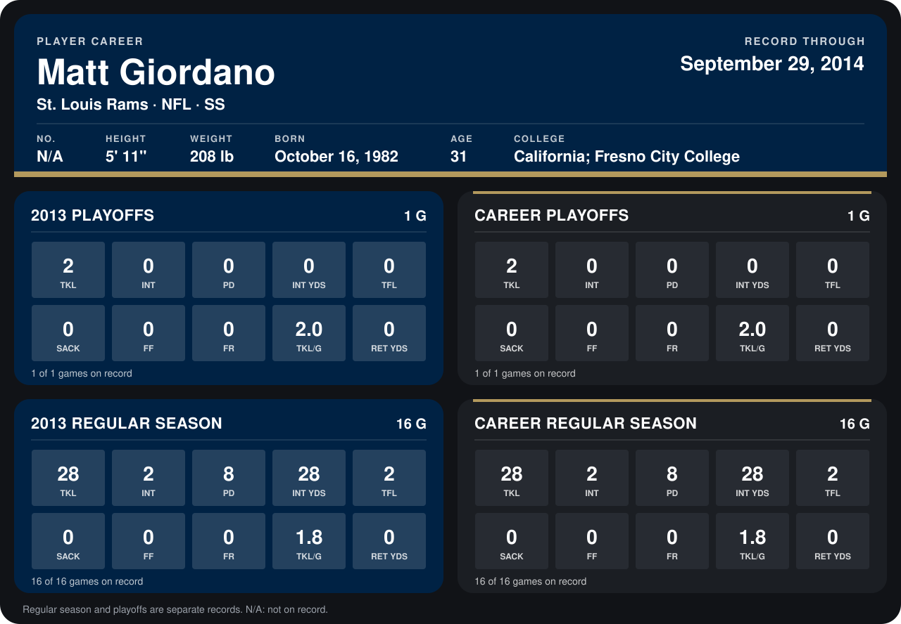

# Matt Giordano

## Career stats

### Regular season

| Season | Team | Age | # | G | TKL | INT | PD | INT YDS | TFL | SACK | FF | FR | TKL/G | RET YDS |
|---|---|---:|---:|---:|---:|---:|---:|---:|---:|---:|---:|---:|---:|---:|
| 2013 | St. Louis Rams | 30 | 27 | 16 | 28 | 2 | 8 | 28 | 2 | 0 | 0 | 0 | 1.8 | 0 |
| **Career** |  |  |  | 16 | 28 | 2 | 8 | 28 | 2 | 0 | 0 | 0 | 1.8 | 0 |

### Playoffs

| Season | Team | Age | # | G | TKL | INT | PD | INT YDS | TFL | SACK | FF | FR | TKL/G | RET YDS |
|---|---|---:|---:|---:|---:|---:|---:|---:|---:|---:|---:|---:|---:|---:|
| 2013 | St. Louis Rams | 30 | 27 | 1 | 2 | 0 | 0 | 0 | 0 | 0 | 0 | 0 | 2.0 | 0 |
| **Career** |  |  |  | 1 | 2 | 0 | 0 | 0 | 0 | 0 | 0 | 0 | 2.0 | 0 |

## Awards

None on record.

Age is his age on the league's opening game of each season; # is the number listed for him that season with that team (2014: the card's rule; 2013: the 2013 season roster), N/A where no listing applies.

Records through January 12, 2014. Identity: his listed 2013 season roster data (no 2014 Weeks 1-4 roster row). [All St. Louis Rams players](README.md).
