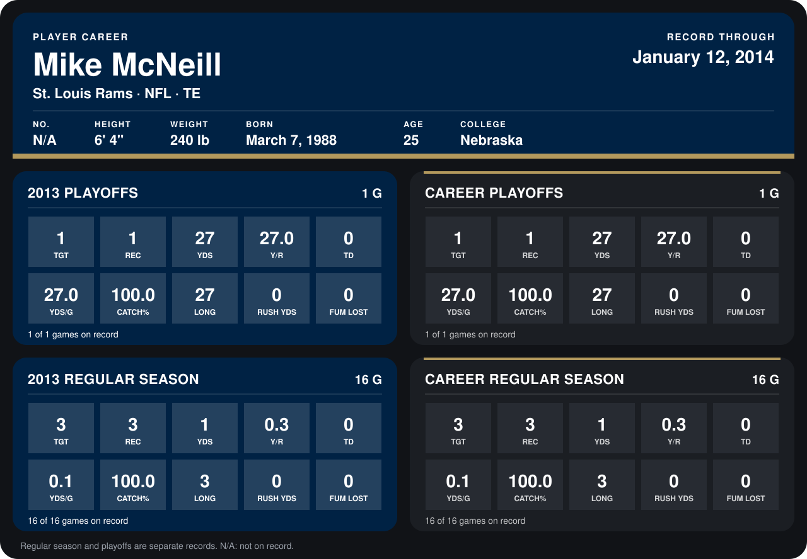

# Mike McNeill

## Career stats

### Regular season

| Season | Club | G | TGT | REC | YDS | Y/R | TD | YDS/G | CATCH% | LONG | RUSH YDS | FUM LOST |
|---|---|---:|---:|---:|---:|---:|---:|---:|---:|---:|---:|---:|
| 2013 | St. Louis Rams | 16 | 3 | 3 | 1 | 0.3 | 0 | 0.1 | 100.0 | 3 | 0 | 0 |
| **Career** |  | 16 | 3 | 3 | 1 | 0.3 | 0 | 0.1 | 100.0 | 3 | 0 | 0 |

### Playoffs

| Season | Club | G | TGT | REC | YDS | Y/R | TD | YDS/G | CATCH% | LONG | RUSH YDS | FUM LOST |
|---|---|---:|---:|---:|---:|---:|---:|---:|---:|---:|---:|---:|
| 2013 | St. Louis Rams | 1 | 1 | 1 | 27 | 27.0 | 0 | 27.0 | 100.0 | 27 | 0 | 0 |
| **Career** |  | 1 | 1 | 1 | 27 | 27.0 | 0 | 27.0 | 100.0 | 27 | 0 | 0 |

## Awards

None on record.

Records through September 29, 2014. Identity: the public player file's latest listing (no 2014 Weeks 1-4 roster row). [All St. Louis Rams players](README.md).
