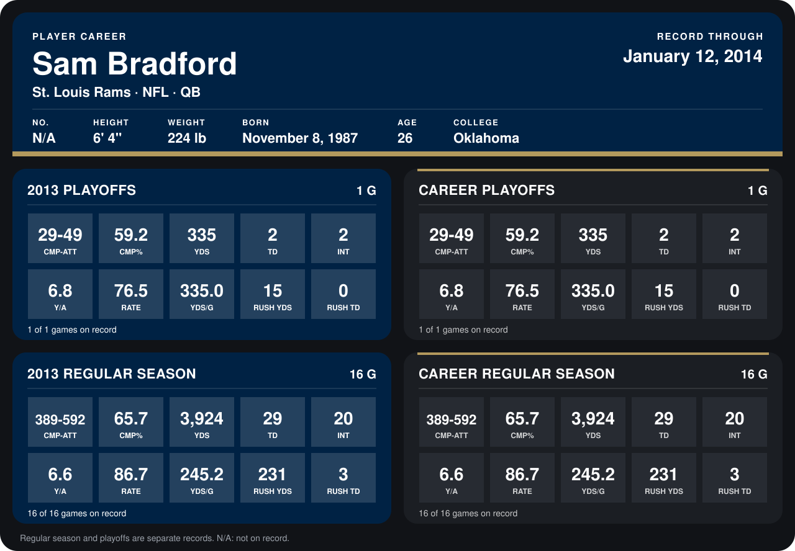

# Sam Bradford

## Career stats

### Regular season

| Season | Club | G | CMP-ATT | CMP% | YDS | TD | INT | Y/A | RATE | YDS/G | RUSH YDS | RUSH TD |
|---|---|---:|---:|---:|---:|---:|---:|---:|---:|---:|---:|---:|
| 2013 | St. Louis Rams | 16 | 389-592 | 65.7 | 3,924 | 29 | 20 | 6.6 | 86.7 | 245.2 | 231 | 3 |
| **Career** |  | 16 | 389-592 | 65.7 | 3,924 | 29 | 20 | 6.6 | 86.7 | 245.2 | 231 | 3 |

### Playoffs

| Season | Club | G | CMP-ATT | CMP% | YDS | TD | INT | Y/A | RATE | YDS/G | RUSH YDS | RUSH TD |
|---|---|---:|---:|---:|---:|---:|---:|---:|---:|---:|---:|---:|
| 2013 | St. Louis Rams | 1 | 29-49 | 59.2 | 335 | 2 | 2 | 6.8 | 76.5 | 335.0 | 15 | 0 |
| **Career** |  | 1 | 29-49 | 59.2 | 335 | 2 | 2 | 6.8 | 76.5 | 335.0 | 15 | 0 |

## Awards

- Pro Bowl selection (2013, QB)

Records through September 29, 2014. Identity: the public player file's latest listing (no 2014 Weeks 1-4 roster row). [All St. Louis Rams players](README.md).
