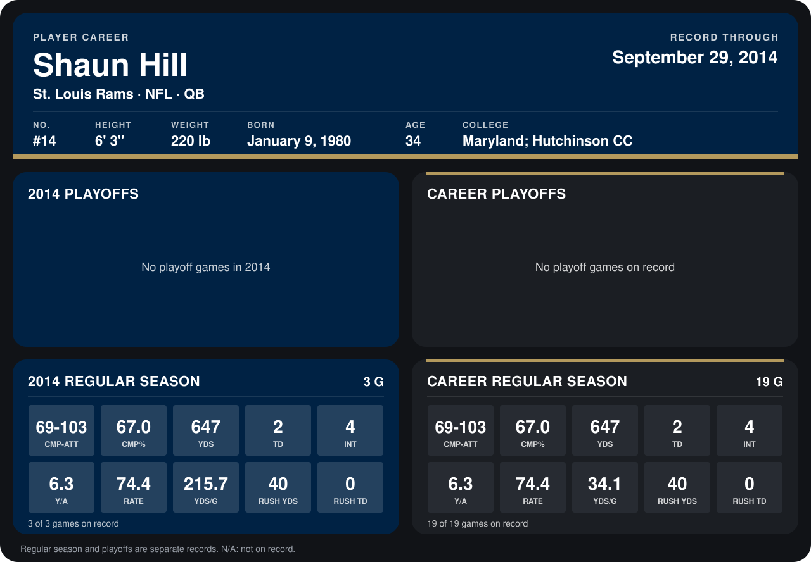

# Shaun Hill

## Career stats

### Regular season

| Season | Club | G | CMP-ATT | CMP% | YDS | TD | INT | Y/A | RATE | YDS/G | RUSH YDS | RUSH TD |
|---|---|---:|---:|---:|---:|---:|---:|---:|---:|---:|---:|---:|
| 2013 | Detroit Lions | 16 | 0-0 | N/A | 0 | 0 | 0 | N/A | N/A | 0.0 | 0 | 0 |
| 2014 | St. Louis Rams | 3 | 69-103 | 67.0 | 647 | 2 | 4 | 6.3 | 74.4 | 215.7 | 40 | 0 |
| **Career** |  | 19 | 69-103 | 67.0 | 647 | 2 | 4 | 6.3 | 74.4 | 34.1 | 40 | 0 |

### Playoffs

No playoff games on record.

## Awards

None on record.

Records through September 21, 2014. Identity: listed 2014 roster data, Weeks 1-4; number: 2014 Week 1 roster. [All St. Louis Rams players](README.md).
