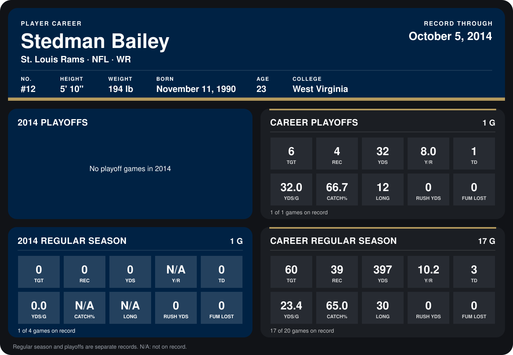

# Stedman Bailey

## Career stats

### Regular season

| Season | Team | Age | # | G | TGT | REC | YDS | Y/R | TD | YDS/G | CATCH% | LONG | RUSH YDS | FUM LOST |
|---|---|---:|---:|---:|---:|---:|---:|---:|---:|---:|---:|---:|---:|---:|
| 2013 | St. Louis Rams | 22 | 12 | 16 | 60 | 39 | 397 | 10.2 | 3 | 24.8 | 65.0 | 30 | 0 | 0 |
| **Career** |  |  |  | 16 | 60 | 39 | 397 | 10.2 | 3 | 24.8 | 65.0 | 30 | 0 | 0 |

### Playoffs

| Season | Team | Age | # | G | TGT | REC | YDS | Y/R | TD | YDS/G | CATCH% | LONG | RUSH YDS | FUM LOST |
|---|---|---:|---:|---:|---:|---:|---:|---:|---:|---:|---:|---:|---:|---:|
| 2013 | St. Louis Rams | 22 | 12 | 1 | 6 | 4 | 32 | 8.0 | 1 | 32.0 | 66.7 | 12 | 0 | 0 |
| **Career** |  |  |  | 1 | 6 | 4 | 32 | 8.0 | 1 | 32.0 | 66.7 | 12 | 0 | 0 |

## Awards

None on record.

Age is his age on the league's opening game of each season; # is the number listed for him that season with that team (2014: the card's rule; 2013: the 2013 season roster), N/A where no listing applies.

Records through January 12, 2014. Identity: listed 2014 roster data, Weeks 1-4; number: 2014 Week 4 roster listing. [All St. Louis Rams players](README.md).
