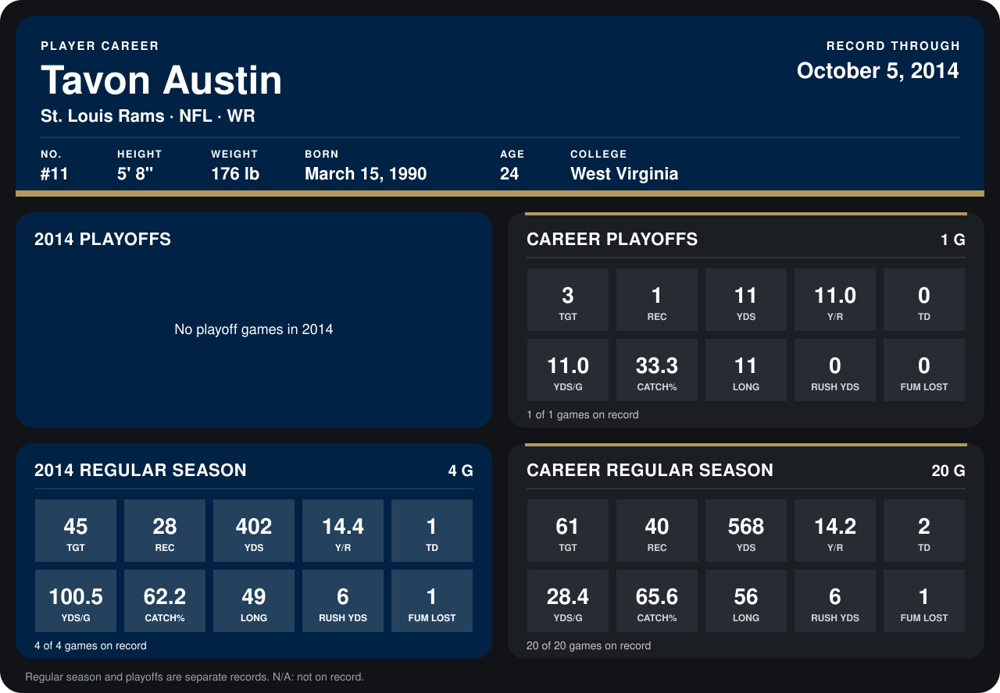

# Tavon Austin

## Career stats

### Regular season

| Season | Club | G | TGT | REC | YDS | Y/R | TD | YDS/G | CATCH% | LONG | RUSH YDS | FUM LOST |
|---|---|---:|---:|---:|---:|---:|---:|---:|---:|---:|---:|---:|
| 2013 | St. Louis Rams | 16 | 16 | 12 | 166 | 13.8 | 1 | 10.4 | 75.0 | 56 | 0 | 0 |
| 2014 | St. Louis Rams | 3 | 31 | 18 | 217 | 12.1 | 1 | 72.3 | 58.1 | 49 | 6 | 0 |
| **Career** |  | 19 | 47 | 30 | 383 | 12.8 | 2 | 20.2 | 63.8 | 56 | 6 | 0 |

### Playoffs

| Season | Club | G | TGT | REC | YDS | Y/R | TD | YDS/G | CATCH% | LONG | RUSH YDS | FUM LOST |
|---|---|---:|---:|---:|---:|---:|---:|---:|---:|---:|---:|---:|
| 2013 | St. Louis Rams | 1 | 3 | 1 | 11 | 11.0 | 0 | 11.0 | 33.3 | 11 | 0 | 0 |
| **Career** |  | 1 | 3 | 1 | 11 | 11.0 | 0 | 11.0 | 33.3 | 11 | 0 | 0 |

## Awards

None on record.

Records through September 29, 2014. Identity: listed 2014 roster data, Weeks 1-4; number: 2014 Week 1 roster. [All St. Louis Rams players](README.md).
