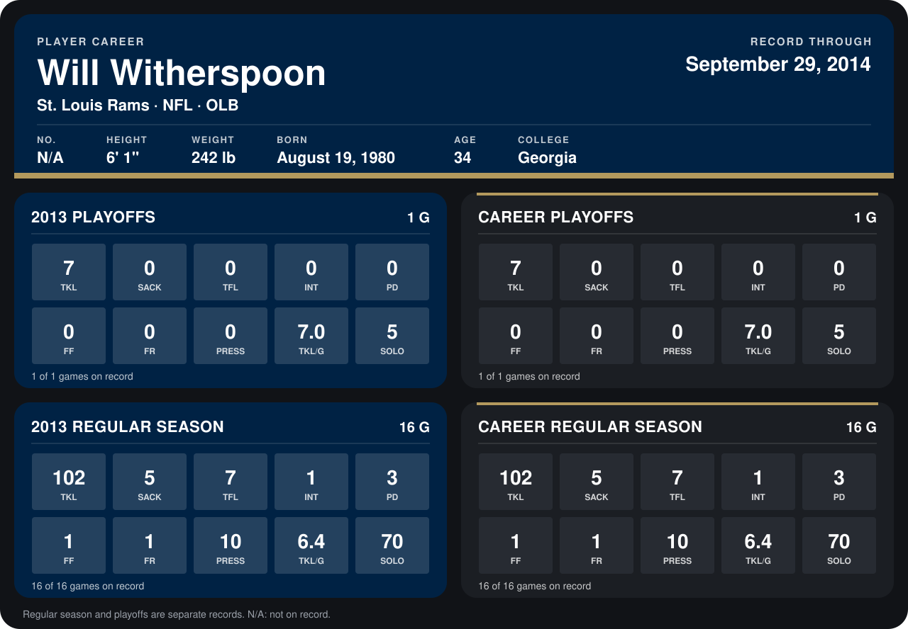

# Will Witherspoon

## Career stats

### Regular season

| Season | Club | G | TKL | SACK | TFL | INT | PD | FF | FR | PRESS | TKL/G | SOLO |
|---|---|---:|---:|---:|---:|---:|---:|---:|---:|---:|---:|---:|
| 2013 | St. Louis Rams | 16 | 102 | 5 | 7 | 1 | 3 | 1 | 1 | 10 | 6.4 | 70 |
| **Career** |  | 16 | 102 | 5 | 7 | 1 | 3 | 1 | 1 | 10 | 6.4 | 70 |

### Playoffs

| Season | Club | G | TKL | SACK | TFL | INT | PD | FF | FR | PRESS | TKL/G | SOLO |
|---|---|---:|---:|---:|---:|---:|---:|---:|---:|---:|---:|---:|
| 2013 | St. Louis Rams | 1 | 7 | 0 | 0 | 0 | 0 | 0 | 0 | 0 | 7.0 | 5 |
| **Career** |  | 1 | 7 | 0 | 0 | 0 | 0 | 0 | 0 | 0 | 7.0 | 5 |

## Awards

None on record.

Records through September 29, 2014. Identity: the public player file's latest listing (no 2014 Weeks 1-4 roster row). [All St. Louis Rams players](README.md).
