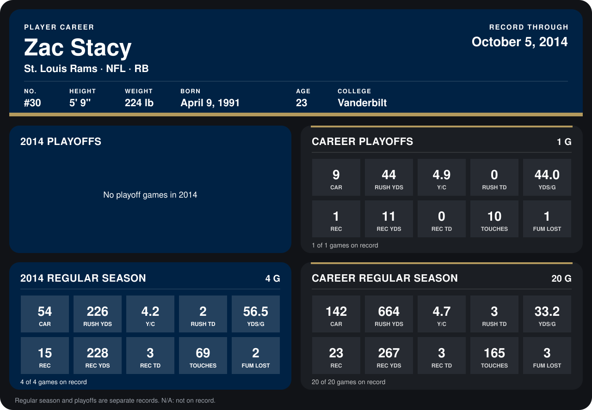

# Zac Stacy

## Career stats

### Regular season

| Season | Team | Age | # | G | CAR | RUSH YDS | Y/C | RUSH TD | YDS/G | REC | REC YDS | REC TD | TOUCHES | FUM LOST |
|---|---|---:|---:|---:|---:|---:|---:|---:|---:|---:|---:|---:|---:|---:|
| 2013 | St. Louis Rams | 22 | 30 | 16 | 88 | 438 | 5.0 | 1 | 27.4 | 8 | 39 | 0 | 96 | 1 |
| 2014 | St. Louis Rams | 23 | 30 | 3 | 40 | 165 | 4.1 | 2 | 55.0 | 10 | 133 | 1 | 50 | 2 |
| **Career** |  |  |  | 19 | 128 | 603 | 4.7 | 3 | 31.7 | 18 | 172 | 1 | 146 | 3 |

### Playoffs

| Season | Team | Age | # | G | CAR | RUSH YDS | Y/C | RUSH TD | YDS/G | REC | REC YDS | REC TD | TOUCHES | FUM LOST |
|---|---|---:|---:|---:|---:|---:|---:|---:|---:|---:|---:|---:|---:|---:|
| 2013 | St. Louis Rams | 22 | 30 | 1 | 9 | 44 | 4.9 | 0 | 44.0 | 1 | 11 | 0 | 10 | 1 |
| **Career** |  |  |  | 1 | 9 | 44 | 4.9 | 0 | 44.0 | 1 | 11 | 0 | 10 | 1 |

## Awards

None on record.

Age is his age on the league's opening game of each season; # is the number listed for him that season with that team (2014: the card's rule; 2013: the 2013 season roster), N/A where no listing applies.

Records through September 21, 2014. Identity: listed 2014 roster data, Weeks 1-4; number: 2014 Week 1 roster. [All St. Louis Rams players](README.md).
