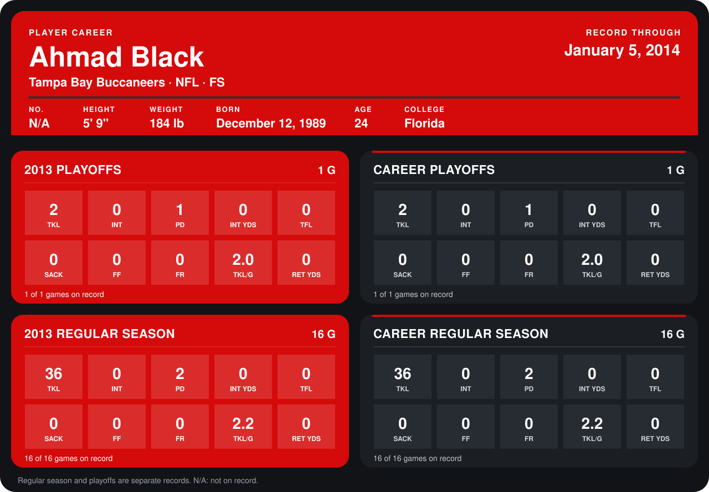

# Ahmad Black

## Career stats

### Regular season

| Season | Club | G | TKL | INT | PD | INT YDS | TFL | SACK | FF | FR | TKL/G | RET YDS |
|---|---|---:|---:|---:|---:|---:|---:|---:|---:|---:|---:|---:|
| 2013 | Tampa Bay Buccaneers | 16 | 36 | 0 | 2 | 0 | 0 | 0 | 0 | 0 | 2.2 | 0 |
| **Career** |  | 16 | 36 | 0 | 2 | 0 | 0 | 0 | 0 | 0 | 2.2 | 0 |

### Playoffs

| Season | Club | G | TKL | INT | PD | INT YDS | TFL | SACK | FF | FR | TKL/G | RET YDS |
|---|---|---:|---:|---:|---:|---:|---:|---:|---:|---:|---:|---:|
| 2013 | Tampa Bay Buccaneers | 1 | 2 | 0 | 1 | 0 | 0 | 0 | 0 | 0 | 2.0 | 0 |
| **Career** |  | 1 | 2 | 0 | 1 | 0 | 0 | 0 | 0 | 0 | 2.0 | 0 |

## Awards

None on record.

Records through September 29, 2014. Identity: the public player file's latest listing (no 2014 Weeks 1-4 roster row). [All Tampa Bay Buccaneers players](README.md).
