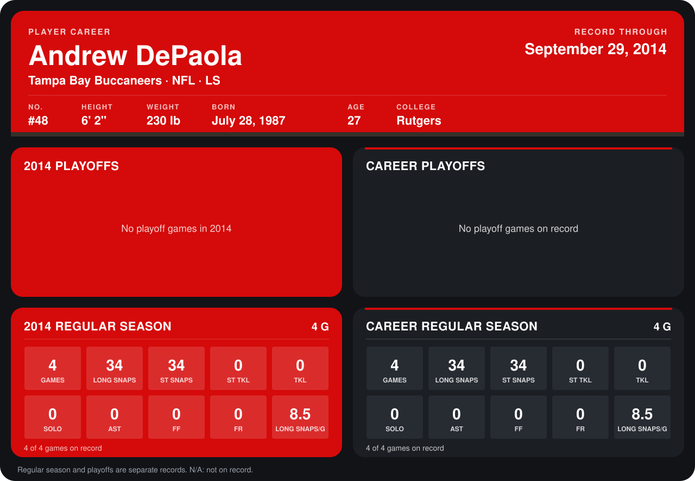

# Andrew DePaola

## Career stats

### Regular season

| Season | Club | G | LONG SNAPS | ST SNAPS | ST TKL | TKL | SOLO | AST | FF | FR | LONG SNAPS/G |
|---|---|---:|---:|---:|---:|---:|---:|---:|---:|---:|---:|
| 2014 | Tampa Bay Buccaneers | 5 | 44 | 44 | 0 | 0 | 0 | 0 | 0 | 0 | 8.8 |
| **Career** |  | 5 | 44 | 44 | 0 | 0 | 0 | 0 | 0 | 0 | 8.8 |

### Playoffs

No playoff games on record.

## Awards

None on record.

Records through October 5, 2014. Identity: listed 2014 roster data, Weeks 1-4; number: 2014 Week 1 roster. [All Tampa Bay Buccaneers players](README.md).
