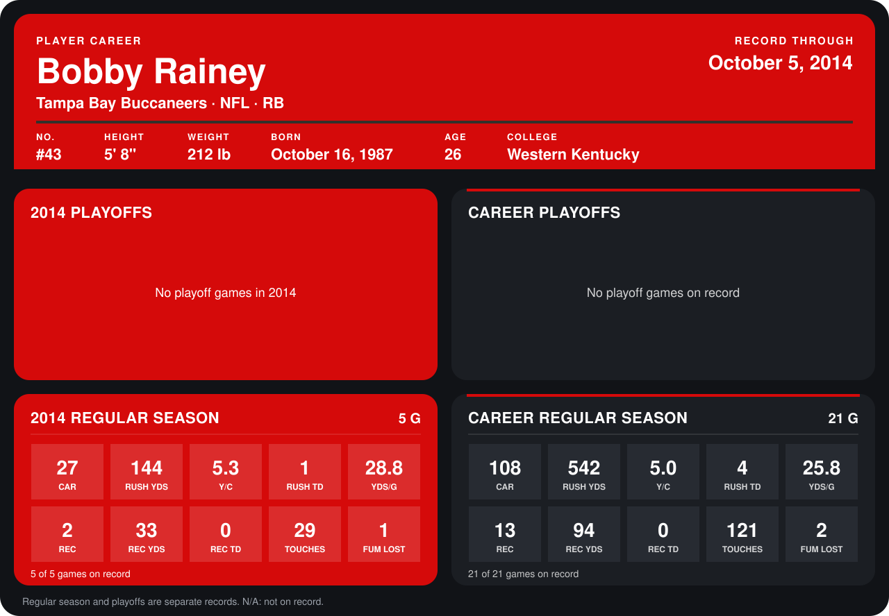

# Bobby Rainey

## Career stats

### Regular season

| Season | Team | Age | # | G | CAR | RUSH YDS | Y/C | RUSH TD | YDS/G | REC | REC YDS | REC TD | TOUCHES | FUM LOST |
|---|---|---:|---:|---:|---:|---:|---:|---:|---:|---:|---:|---:|---:|---:|
| 2013 | Cleveland Browns | 25 | N/A | 16 | 81 | 398 | 4.9 | 3 | 24.9 | 11 | 61 | 0 | 92 | 1 |
| 2014 | Tampa Bay Buccaneers | 26 | 43 | 4 | 22 | 115 | 5.2 | 1 | 28.8 | 2 | 33 | 0 | 24 | 1 |
| **Career** |  |  |  | 20 | 103 | 513 | 5.0 | 4 | 25.6 | 13 | 94 | 0 | 116 | 2 |

### Playoffs

No playoff games on record.

## Awards

None on record.

Age is his age on the league's opening game of each season; # is the number listed for him that season with that team (2014: the card's rule; 2013: the 2013 season roster), N/A where no listing applies.

Records through September 28, 2014. Identity: listed 2014 roster data, Weeks 1-4; number: 2014 Week 1 roster. [All Tampa Bay Buccaneers players](README.md).
