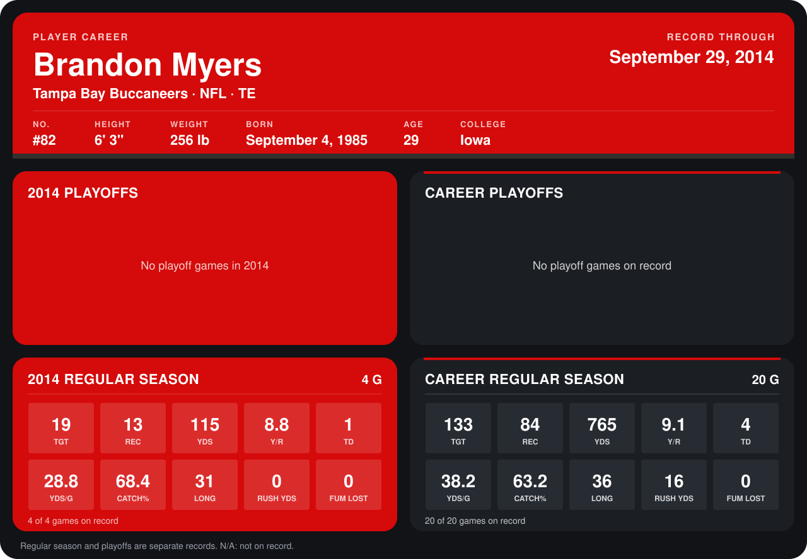

# Brandon Myers

## Career stats

### Regular season

| Season | Club | G | TGT | REC | YDS | Y/R | TD | YDS/G | CATCH% | LONG | RUSH YDS | FUM LOST |
|---|---|---:|---:|---:|---:|---:|---:|---:|---:|---:|---:|---:|
| 2013 | New York Giants | 16 | 114 | 71 | 650 | 9.2 | 3 | 40.6 | 62.3 | 36 | 16 | 0 |
| 2014 | Tampa Bay Buccaneers | 5 | 25 | 16 | 137 | 8.6 | 1 | 27.4 | 64.0 | 31 | 0 | 0 |
| **Career** |  | 21 | 139 | 87 | 787 | 9.0 | 4 | 37.5 | 62.6 | 36 | 16 | 0 |

### Playoffs

No playoff games on record.

## Awards

None on record.

Records through October 5, 2014. Identity: listed 2014 roster data, Weeks 1-4; number: 2014 Week 1 roster. [All Tampa Bay Buccaneers players](README.md).
