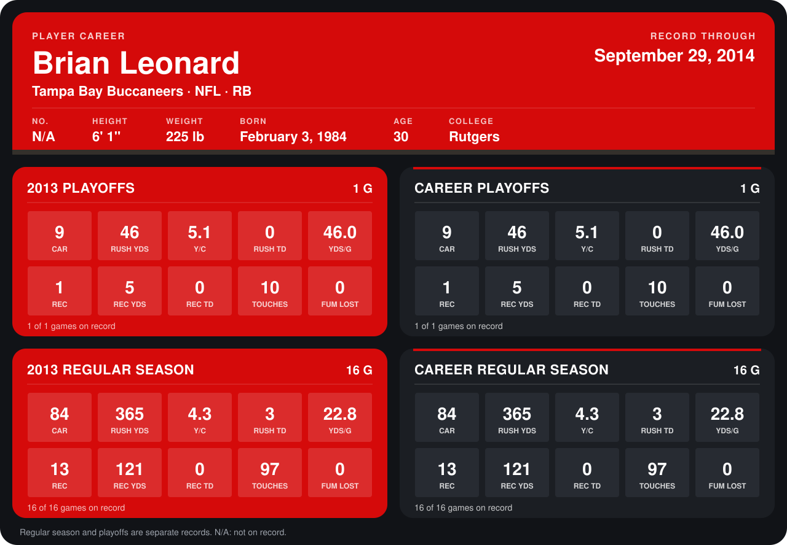

# Brian Leonard

## Career stats

### Regular season

| Season | Team | Age | # | G | CAR | RUSH YDS | Y/C | RUSH TD | YDS/G | REC | REC YDS | REC TD | TOUCHES | FUM LOST |
|---|---|---:|---:|---:|---:|---:|---:|---:|---:|---:|---:|---:|---:|---:|
| 2013 | Tampa Bay Buccaneers | 29 | 30 | 16 | 84 | 365 | 4.3 | 3 | 22.8 | 13 | 121 | 0 | 97 | 0 |
| **Career** |  |  |  | 16 | 84 | 365 | 4.3 | 3 | 22.8 | 13 | 121 | 0 | 97 | 0 |

### Playoffs

| Season | Team | Age | # | G | CAR | RUSH YDS | Y/C | RUSH TD | YDS/G | REC | REC YDS | REC TD | TOUCHES | FUM LOST |
|---|---|---:|---:|---:|---:|---:|---:|---:|---:|---:|---:|---:|---:|---:|
| 2013 | Tampa Bay Buccaneers | 29 | 30 | 1 | 9 | 46 | 5.1 | 0 | 46.0 | 1 | 5 | 0 | 10 | 0 |
| **Career** |  |  |  | 1 | 9 | 46 | 5.1 | 0 | 46.0 | 1 | 5 | 0 | 10 | 0 |

## Awards

None on record.

Age is his age on the league's opening game of each season; # is the number listed for him that season with that team (2014: the card's rule; 2013: the 2013 season roster), N/A where no listing applies.

Records through January 5, 2014. Identity: his listed 2013 season roster data (no 2014 Weeks 1-4 roster row). [All Tampa Bay Buccaneers players](README.md).
