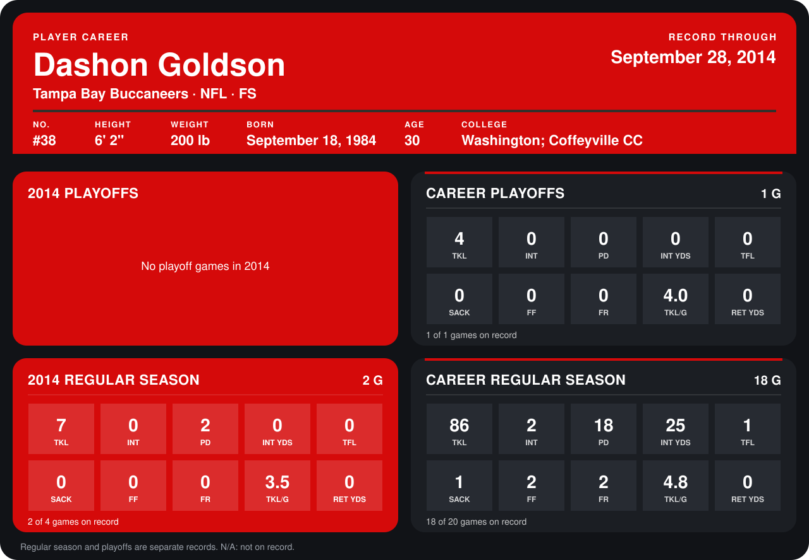

# Dashon Goldson

## Career stats

### Regular season

| Season | Club | G | TKL | INT | PD | INT YDS | TFL | SACK | FF | FR | TKL/G | RET YDS |
|---|---|---:|---:|---:|---:|---:|---:|---:|---:|---:|---:|---:|
| 2013 | Tampa Bay Buccaneers | 16 | 79 | 2 | 16 | 25 | 1 | 1 | 2 | 2 | 4.9 | 0 |
| 2014 | Tampa Bay Buccaneers | 2 | 7 | 0 | 2 | 0 | 0 | 0 | 0 | 0 | 3.5 | 0 |
| **Career** |  | 18 | 86 | 2 | 18 | 25 | 1 | 1 | 2 | 2 | 4.8 | 0 |

### Playoffs

| Season | Club | G | TKL | INT | PD | INT YDS | TFL | SACK | FF | FR | TKL/G | RET YDS |
|---|---|---:|---:|---:|---:|---:|---:|---:|---:|---:|---:|---:|
| 2013 | Tampa Bay Buccaneers | 1 | 4 | 0 | 0 | 0 | 0 | 0 | 0 | 0 | 4.0 | 0 |
| **Career** |  | 1 | 4 | 0 | 0 | 0 | 0 | 0 | 0 | 0 | 4.0 | 0 |

## Awards

None on record.

Records through October 5, 2014. Identity: listed 2014 roster data, Weeks 1-4; number: 2014 Week 1 roster. [All Tampa Bay Buccaneers players](README.md).
