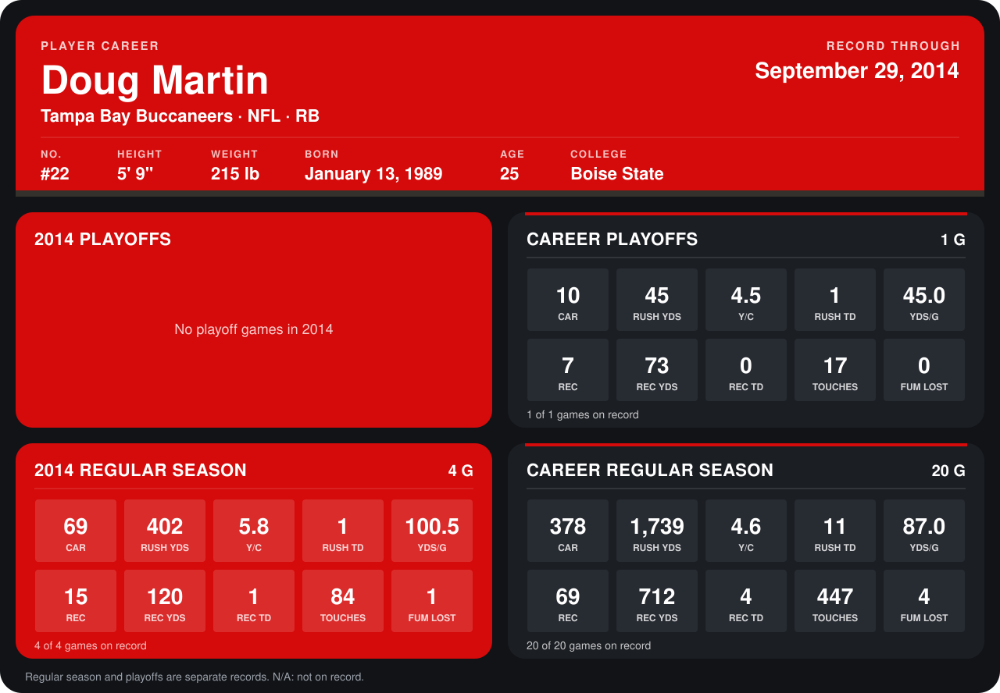

# Doug Martin

## Career stats

### Regular season

| Season | Club | G | CAR | RUSH YDS | Y/C | RUSH TD | YDS/G | REC | REC YDS | REC TD | TOUCHES | FUM LOST |
|---|---|---:|---:|---:|---:|---:|---:|---:|---:|---:|---:|---:|
| 2013 | Tampa Bay Buccaneers | 16 | 309 | 1,337 | 4.3 | 10 | 83.6 | 54 | 592 | 3 | 363 | 3 |
| 2014 | Tampa Bay Buccaneers | 5 | 89 | 507 | 5.7 | 1 | 101.4 | 18 | 143 | 1 | 107 | 1 |
| **Career** |  | 21 | 398 | 1,844 | 4.6 | 11 | 87.8 | 72 | 735 | 4 | 470 | 4 |

### Playoffs

| Season | Club | G | CAR | RUSH YDS | Y/C | RUSH TD | YDS/G | REC | REC YDS | REC TD | TOUCHES | FUM LOST |
|---|---|---:|---:|---:|---:|---:|---:|---:|---:|---:|---:|---:|
| 2013 | Tampa Bay Buccaneers | 1 | 10 | 45 | 4.5 | 1 | 45.0 | 7 | 73 | 0 | 17 | 0 |
| **Career** |  | 1 | 10 | 45 | 4.5 | 1 | 45.0 | 7 | 73 | 0 | 17 | 0 |

## Awards

None on record.

Records through October 5, 2014. Identity: listed 2014 roster data, Weeks 1-4; number: 2014 Week 1 roster. [All Tampa Bay Buccaneers players](README.md).
