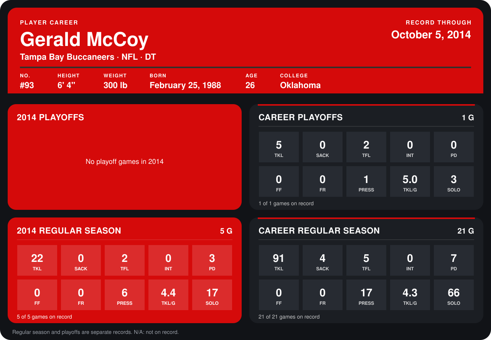

# Gerald McCoy

## Career stats

### Regular season

| Season | Club | G | TKL | SACK | TFL | INT | PD | FF | FR | PRESS | TKL/G | SOLO |
|---|---|---:|---:|---:|---:|---:|---:|---:|---:|---:|---:|---:|
| 2013 | Tampa Bay Buccaneers | 16 | 69 | 4 | 3 | 0 | 4 | 0 | 0 | 11 | 4.3 | 49 |
| 2014 | Tampa Bay Buccaneers | 4 | 20 | 0 | 2 | 0 | 2 | 0 | 0 | 6 | 5.0 | 16 |
| **Career** |  | 20 | 89 | 4 | 5 | 0 | 6 | 0 | 0 | 17 | 4.5 | 65 |

### Playoffs

| Season | Club | G | TKL | SACK | TFL | INT | PD | FF | FR | PRESS | TKL/G | SOLO |
|---|---|---:|---:|---:|---:|---:|---:|---:|---:|---:|---:|---:|
| 2013 | Tampa Bay Buccaneers | 1 | 5 | 0 | 2 | 0 | 0 | 0 | 0 | 1 | 5.0 | 3 |
| **Career** |  | 1 | 5 | 0 | 2 | 0 | 0 | 0 | 0 | 1 | 5.0 | 3 |

## Awards

None on record.

Records through September 29, 2014. Identity: listed 2014 roster data, Weeks 1-4; number: 2014 Week 1 roster. [All Tampa Bay Buccaneers players](README.md).
