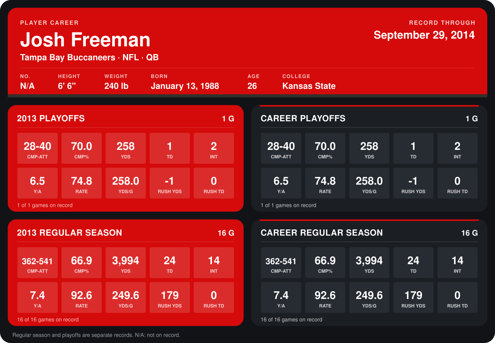

# Josh Freeman

## Career stats

### Regular season

| Season | Team | Age | # | G | CMP-ATT | CMP% | YDS | TD | INT | Y/A | RATE | YDS/G | RUSH YDS | RUSH TD |
|---|---|---:|---:|---:|---:|---:|---:|---:|---:|---:|---:|---:|---:|---:|
| 2013 | Tampa Bay Buccaneers | 25 | N/A | 16 | 362-541 | 66.9 | 3,994 | 24 | 14 | 7.4 | 92.6 | 249.6 | 179 | 0 |
| **Career** |  |  |  | 16 | 362-541 | 66.9 | 3,994 | 24 | 14 | 7.4 | 92.6 | 249.6 | 179 | 0 |

### Playoffs

| Season | Team | Age | # | G | CMP-ATT | CMP% | YDS | TD | INT | Y/A | RATE | YDS/G | RUSH YDS | RUSH TD |
|---|---|---:|---:|---:|---:|---:|---:|---:|---:|---:|---:|---:|---:|---:|
| 2013 | Tampa Bay Buccaneers | 25 | N/A | 1 | 28-40 | 70.0 | 258 | 1 | 2 | 6.5 | 74.8 | 258.0 | -1 | 0 |
| **Career** |  |  |  | 1 | 28-40 | 70.0 | 258 | 1 | 2 | 6.5 | 74.8 | 258.0 | -1 | 0 |

## Awards

None on record.

Age is his age on the league's opening game of each season; # is the number listed for him that season with that team (2014: the card's rule; 2013: the 2013 season roster), N/A where no listing applies.

Records through January 5, 2014. Identity: his listed 2013 season roster data (no 2014 Weeks 1-4 roster row). [All Tampa Bay Buccaneers players](README.md).
