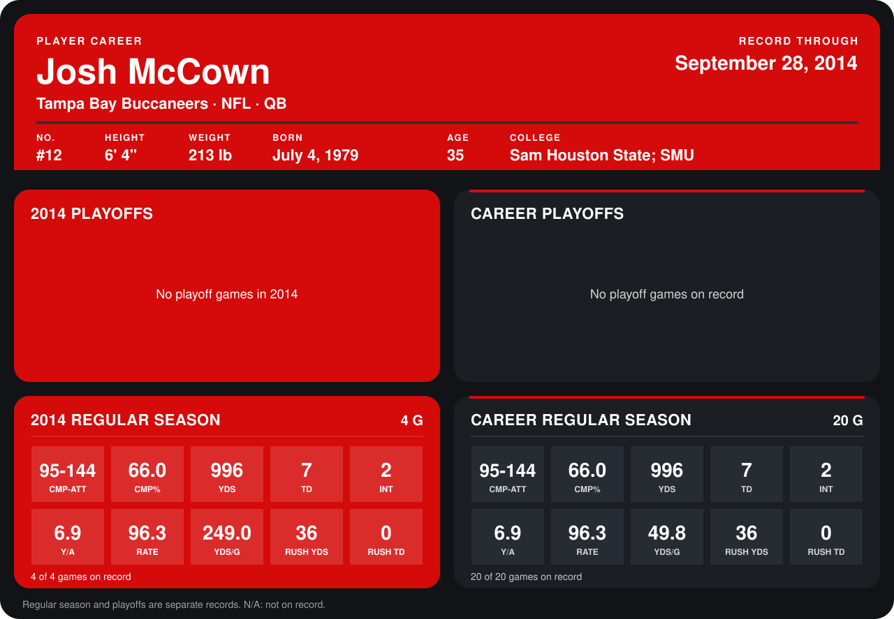

# Josh McCown

## Career stats

### Regular season

| Season | Club | G | CMP-ATT | CMP% | YDS | TD | INT | Y/A | RATE | YDS/G | RUSH YDS | RUSH TD |
|---|---|---:|---:|---:|---:|---:|---:|---:|---:|---:|---:|---:|
| 2013 | Chicago Bears | 16 | 0-0 | N/A | 0 | 0 | 0 | N/A | N/A | 0.0 | 0 | 0 |
| 2014 | Tampa Bay Buccaneers | 4 | 95-144 | 66.0 | 996 | 7 | 2 | 6.9 | 96.3 | 249.0 | 36 | 0 |
| **Career** |  | 20 | 95-144 | 66.0 | 996 | 7 | 2 | 6.9 | 96.3 | 49.8 | 36 | 0 |

### Playoffs

No playoff games on record.

## Awards

None on record.

Records through September 29, 2014. Identity: listed 2014 roster data, Weeks 1-4; number: 2014 Week 1 roster. [All Tampa Bay Buccaneers players](README.md).
