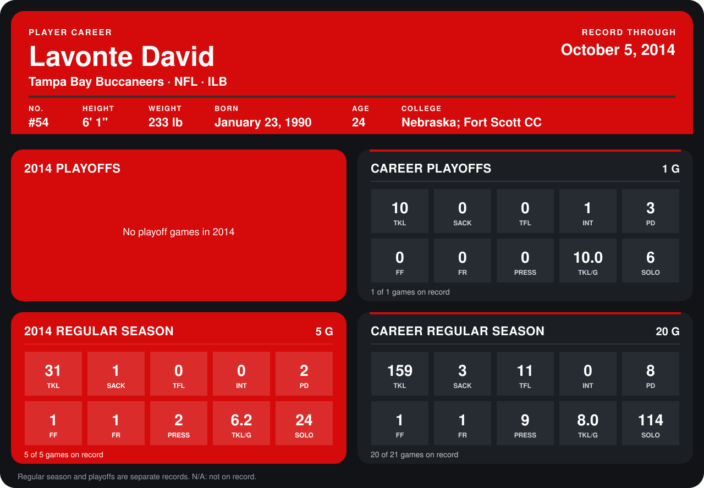

# Lavonte David

## Career stats

### Regular season

| Season | Club | G | TKL | SACK | TFL | INT | PD | FF | FR | PRESS | TKL/G | SOLO |
|---|---|---:|---:|---:|---:|---:|---:|---:|---:|---:|---:|---:|
| 2013 | Tampa Bay Buccaneers | 15 | 128 | 2 | 11 | 0 | 6 | 0 | 0 | 7 | 8.5 | 90 |
| 2014 | Tampa Bay Buccaneers | 4 | 25 | 1 | 0 | 0 | 0 | 1 | 1 | 2 | 6.2 | 20 |
| **Career** |  | 19 | 153 | 3 | 11 | 0 | 6 | 1 | 1 | 9 | 8.1 | 110 |

### Playoffs

| Season | Club | G | TKL | SACK | TFL | INT | PD | FF | FR | PRESS | TKL/G | SOLO |
|---|---|---:|---:|---:|---:|---:|---:|---:|---:|---:|---:|---:|
| 2013 | Tampa Bay Buccaneers | 1 | 10 | 0 | 0 | 1 | 3 | 0 | 0 | 0 | 10.0 | 6 |
| **Career** |  | 1 | 10 | 0 | 0 | 1 | 3 | 0 | 0 | 0 | 10.0 | 6 |

## Awards

None on record.

Records through September 28, 2014. Identity: listed 2014 roster data, Weeks 1-4; number: 2014 Week 1 roster. [All Tampa Bay Buccaneers players](README.md).
