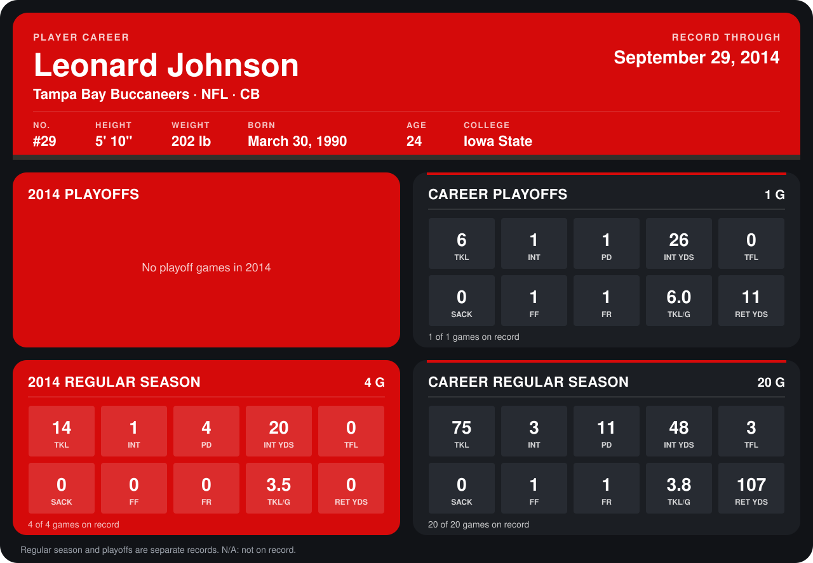

# Leonard Johnson

## Career stats

### Regular season

| Season | Club | G | TKL | INT | PD | INT YDS | TFL | SACK | FF | FR | TKL/G | RET YDS |
|---|---|---:|---:|---:|---:|---:|---:|---:|---:|---:|---:|---:|
| 2013 | Tampa Bay Buccaneers | 16 | 61 | 2 | 7 | 28 | 3 | 0 | 1 | 1 | 3.8 | 107 |
| 2014 | Tampa Bay Buccaneers | 4 | 14 | 1 | 4 | 20 | 0 | 0 | 0 | 0 | 3.5 | 0 |
| **Career** |  | 20 | 75 | 3 | 11 | 48 | 3 | 0 | 1 | 1 | 3.8 | 107 |

### Playoffs

| Season | Club | G | TKL | INT | PD | INT YDS | TFL | SACK | FF | FR | TKL/G | RET YDS |
|---|---|---:|---:|---:|---:|---:|---:|---:|---:|---:|---:|---:|
| 2013 | Tampa Bay Buccaneers | 1 | 6 | 1 | 1 | 26 | 0 | 0 | 1 | 1 | 6.0 | 11 |
| **Career** |  | 1 | 6 | 1 | 1 | 26 | 0 | 0 | 1 | 1 | 6.0 | 11 |

## Awards

None on record.

Records through September 29, 2014. Identity: listed 2014 roster data, Weeks 1-4; number: 2014 Week 1 roster. [All Tampa Bay Buccaneers players](README.md).
