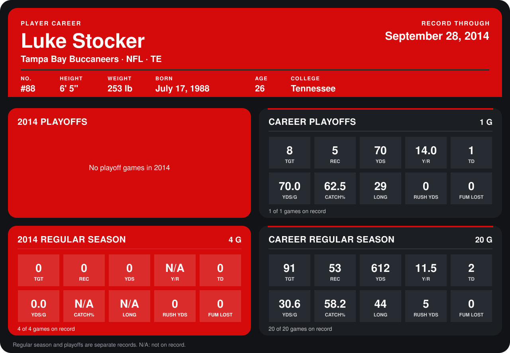

# Luke Stocker

## Career stats

### Regular season

| Season | Club | G | TGT | REC | YDS | Y/R | TD | YDS/G | CATCH% | LONG | RUSH YDS | FUM LOST |
|---|---|---:|---:|---:|---:|---:|---:|---:|---:|---:|---:|---:|
| 2013 | Tampa Bay Buccaneers | 16 | 91 | 53 | 612 | 11.5 | 2 | 38.2 | 58.2 | 44 | 5 | 0 |
| 2014 | Tampa Bay Buccaneers | 4 | 0 | 0 | 0 | N/A | 0 | 0.0 | N/A | N/A | 0 | 0 |
| **Career** |  | 20 | 91 | 53 | 612 | 11.5 | 2 | 30.6 | 58.2 | 44 | 5 | 0 |

### Playoffs

| Season | Club | G | TGT | REC | YDS | Y/R | TD | YDS/G | CATCH% | LONG | RUSH YDS | FUM LOST |
|---|---|---:|---:|---:|---:|---:|---:|---:|---:|---:|---:|---:|
| 2013 | Tampa Bay Buccaneers | 1 | 8 | 5 | 70 | 14.0 | 1 | 70.0 | 62.5 | 29 | 0 | 0 |
| **Career** |  | 1 | 8 | 5 | 70 | 14.0 | 1 | 70.0 | 62.5 | 29 | 0 | 0 |

## Awards

None on record.

Records through September 29, 2014. Identity: listed 2014 roster data, Weeks 1-4; number: 2014 Week 1 roster. [All Tampa Bay Buccaneers players](README.md).
