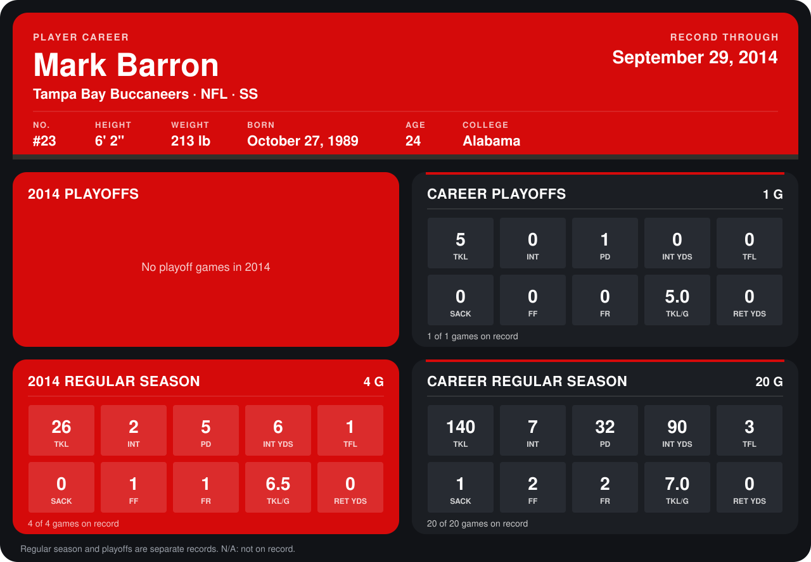

# Mark Barron

## Career stats

### Regular season

| Season | Club | G | TKL | INT | PD | INT YDS | TFL | SACK | FF | FR | TKL/G | RET YDS |
|---|---|---:|---:|---:|---:|---:|---:|---:|---:|---:|---:|---:|
| 2013 | Tampa Bay Buccaneers | 16 | 114 | 5 | 27 | 84 | 2 | 1 | 1 | 1 | 7.1 | 0 |
| 2014 | Tampa Bay Buccaneers | 4 | 26 | 2 | 5 | 6 | 1 | 0 | 1 | 1 | 6.5 | 0 |
| **Career** |  | 20 | 140 | 7 | 32 | 90 | 3 | 1 | 2 | 2 | 7.0 | 0 |

### Playoffs

| Season | Club | G | TKL | INT | PD | INT YDS | TFL | SACK | FF | FR | TKL/G | RET YDS |
|---|---|---:|---:|---:|---:|---:|---:|---:|---:|---:|---:|---:|
| 2013 | Tampa Bay Buccaneers | 1 | 5 | 0 | 1 | 0 | 0 | 0 | 0 | 0 | 5.0 | 0 |
| **Career** |  | 1 | 5 | 0 | 1 | 0 | 0 | 0 | 0 | 0 | 5.0 | 0 |

## Awards

- NFC Defensive Player of the Week (2013, Week 17)
- AP Second-Team All-Pro (2013, S)

Records through September 28, 2014. Identity: listed 2014 roster data, Weeks 1-4; number: 2014 Week 1 roster. [All Tampa Bay Buccaneers players](README.md).
