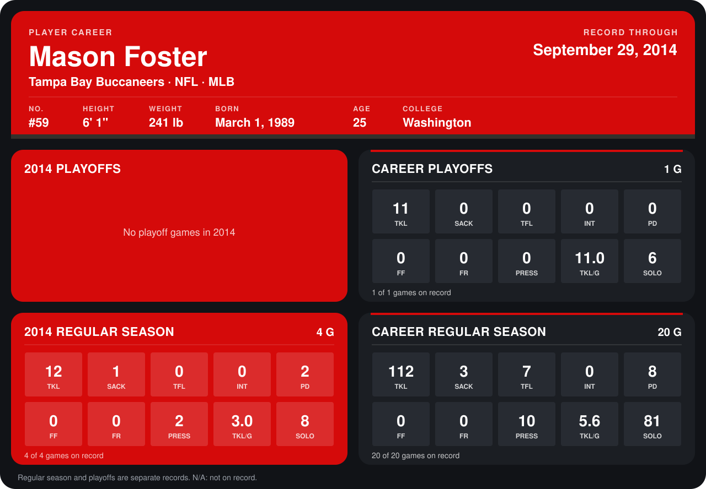

# Mason Foster

## Career stats

### Regular season

| Season | Team | Age | # | G | TKL | SACK | TFL | INT | PD | FF | FR | PRESS | TKL/G | SOLO |
|---|---|---:|---:|---:|---:|---:|---:|---:|---:|---:|---:|---:|---:|---:|
| 2013 | Tampa Bay Buccaneers | 24 | 59 | 16 | 100 | 2 | 7 | 0 | 6 | 0 | 0 | 8 | 6.2 | 73 |
| 2014 | Tampa Bay Buccaneers | 25 | 59 | 4 | 12 | 1 | 0 | 0 | 2 | 0 | 0 | 2 | 3.0 | 8 |
| **Career** |  |  |  | 20 | 112 | 3 | 7 | 0 | 8 | 0 | 0 | 10 | 5.6 | 81 |

### Playoffs

| Season | Team | Age | # | G | TKL | SACK | TFL | INT | PD | FF | FR | PRESS | TKL/G | SOLO |
|---|---|---:|---:|---:|---:|---:|---:|---:|---:|---:|---:|---:|---:|---:|
| 2013 | Tampa Bay Buccaneers | 24 | 59 | 1 | 11 | 0 | 0 | 0 | 0 | 0 | 0 | 0 | 11.0 | 6 |
| **Career** |  |  |  | 1 | 11 | 0 | 0 | 0 | 0 | 0 | 0 | 0 | 11.0 | 6 |

## Awards

None on record.

Age is his age on the league's opening game of each season; # is the number listed for him that season with that team (2014: the card's rule; 2013: the 2013 season roster), N/A where no listing applies.

Records through September 28, 2014. Identity: listed 2014 roster data, Weeks 1-4; number: 2014 Week 1 roster. [All Tampa Bay Buccaneers players](README.md).
